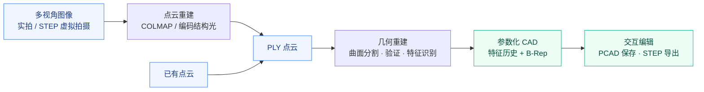

# Bochu-ParamCAD

**从多视角图像与点云，到可编辑的参数化 CAD。**

ParamCAD Studio 是本项目的 Windows 桌面客户端，串联图像重建、几何识别与参数化建模，支持参数编辑、工程保存和 STEP 导出。

[📖 在线文档](https://ghhufue.github.io/Bochu-ParamCAD/) · [🚀 快速开始](https://ghhufue.github.io/Bochu-ParamCAD/getting-started/) · [🛠 安装与构建](https://ghhufue.github.io/Bochu-ParamCAD/getting-started/installation)

## 核心流程



## 主要能力

| | 能力概览 |
| --- | --- |
| 📷 图像到点云 | 多视角虚拟拍摄、COLMAP 重建、编码结构光仿真 |
| 🧩 点云到模型 | 解析曲面检测、特征识别、多体分组与闭合，支持人工引导 |
| ✏️ 参数化编辑 | 草图与拉伸 / 切除、特征参数调整、限定中文指令修改、撤销 / 重做 |
| 📦 工作流交付 | `.pcad` 工程、STEP 导出、统一 `pcad` CLI 与 Windows 离线包 |

当前面向已验证的几何类型与案例；复杂零件、遮挡和缺失观测下的恢复能力仍在扩展。适用范围与验证结果见在线文档。

## 文档导航

| 想做什么 | 从这里开始 |
| --- | --- |
| 完成第一次重建 | [点云到 CAD](https://ghhufue.github.io/Bochu-ParamCAD/getting-started/first-reconstruction) · [图像到点云](https://ghhufue.github.io/Bochu-ParamCAD/getting-started/images-to-cloud) |
| 理解处理流程 | [系统架构](https://ghhufue.github.io/Bochu-ParamCAD/architecture/) · [模块手册](https://ghhufue.github.io/Bochu-ParamCAD/modules/) · [算法原理](https://ghhufue.github.io/Bochu-ParamCAD/algorithms/) |
| 使用命令行与批处理 | [CLI 使用指南](https://ghhufue.github.io/Bochu-ParamCAD/cli/) |
| 查看效果与性能 | [案例与验证](https://ghhufue.github.io/Bochu-ParamCAD/validation/) · [性能调优](https://ghhufue.github.io/Bochu-ParamCAD/performance/) |
| 参与开发 | [开发维护](https://ghhufue.github.io/Bochu-ParamCAD/development/) |

## 代码地图

```text
apps/ParamCAD Studio/           Qt + VTK 桌面客户端
core/reconstruction/           图像 → 点云
core/geometric_reconstruction/ 点云 → 几何与特征
core/parametric_modeling/       特征 → OpenCASCADE B-Rep
tools/                         CLI、验证与诊断工具
packaging/                     Windows 离线打包
docs/                          GitHub Pages 文档站
```

技术栈：**C++17 · Python · Qt · VTK · OpenCASCADE · CGAL · COLMAP**
