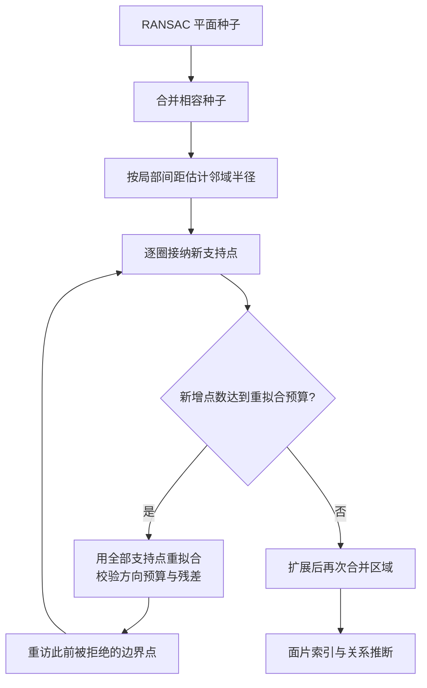

# 解析曲面拟合和连通扩展

曲面证据由 `core/geometric_reconstruction/src/segmentation` 生成：CGAL 6.2.1 的 Efficient RANSAC 提出候选，项目代码归一化参数、按支持点精修、计算残差与覆盖率，最后交给多轮检测做区域级竞争。证据只是候选，不保证对应真实 CAD 面；可能产生部分面、重复面或伪面。

## 基元的参数表达

五类基元的参数与自由度如下。自由度按“法向或轴向取单位向量”计：

| 基元 | 参数 | 自由度 | 残差 |
| --- | --- | --- | --- |
| 平面 | 单位法向 $\mathbf{n}$、偏移 $d$ | 3 | $\lvert \mathbf{n}\cdot\mathbf{p}+d\rvert$ |
| 圆柱 | 轴上一点 $\mathbf{a}$、单位轴 $\mathbf{u}$、半径 $r$ | 5 | $\lvert \rho(\mathbf{p})-r\rvert$ |
| 球 | 球心 $\mathbf{c}$、半径 $r$ | 4 | $\lvert \lVert\mathbf{p}-\mathbf{c}\rVert-r\rvert$ |
| 圆锥 | 顶点 $\mathbf{a}$、单位轴 $\mathbf{u}$、半顶角 $\alpha$ | 6 | $\lvert \cos\alpha\,\rho-\sin\alpha\,t\rvert$ |
| 圆环 | 圆心 $\mathbf{c}$、单位轴 $\mathbf{u}$、主半径 $R$、管半径 $r$ | 7 | $\lvert \lVert\mathbf{p}-(\mathbf{c}+R\hat{\boldsymbol{\rho}})\rVert-r\rvert$ |

其中圆柱的 $\rho(\mathbf{p})=\lVert(\mathbf{p}-\mathbf{a})-((\mathbf{p}-\mathbf{a})\cdot\mathbf{u})\mathbf{u}\rVert$；圆锥的 $t=(\mathbf{p}-\mathbf{a})\cdot\mathbf{u}$，$\rho$ 为到轴的径向距离；圆环的 $\hat{\boldsymbol{\rho}}$ 是点到轴径向方向。代码把圆柱轴上一点投影到过原点的垂足，保证同一条轴只有一种表示。

平面方程在 `SurfaceEvidence.h` 中定义为 $\mathbf{n}\cdot\mathbf{p}+d=0$，平面法向由支持点协方差的最小特征向量给出；圆柱残差与轴向坐标、径向方向由 `CylinderEvidence.cpp` 中的 `cylinderResidual` 同时返回，供支持点筛选和角度统计复用。

## Efficient RANSAC

RANSAC 给出解析曲面提议，其中自动平面的支持点还会经过下一节的连通扩展，避免大平面被初始法向截成窄条。拓展后的面范围仍须经过[有限支撑验证](/algorithms/surface-support-validation)，再参与下游特征判断。

`CgalEfficientRansacDetector.cpp` 在一次 CGAL Efficient RANSAC 中同时注册五类形状工厂。只有带有效法向的点进入 CGAL；零法向或非有限法向被丢弃。跨家族合并参数的口径是：最小支持点取五类中的最小值，概率取最小值，距离阈值取最大值，法向对齐阈值取最小值，聚类阈值取显式最大值；显式聚类阈值为 0 时使用 $\max(3\varepsilon,\,0.1D)$，$D$ 为包围盒对角线。

每类基元有独立的最大数量；当前 `detection.conf` 为平面6、圆柱8、球/圆锥/圆环各32，任务可覆盖上限，超出有效上限的部分被丢弃。裸选项结构的初值与配置值不同，见[检测输入与输出](/modules/surface-detection#输入与输出)。概率默认0.01，法向对齐默认0.9。随机种子默认4500，检测使用隔离的随机流并在结束后恢复调用方的CGAL状态，因此相同输入与参数可复现；改变种子可用于稳健性探测。

检测入口会拒绝三类输入：没有任何启用家族、选项越界、以及点数不足或所有点位置完全相同。RANSAC 本身是随机算法，不保证全局最优或完整；支持点少、遮挡严重或近似退化的区域可能漏检。

## 平面支持连通扩展 {#plane-support-recovery}

扩展在共享曲面收集入口 `collectSurfaceEvidence()` 中对自动平面运行，表面识别和常规 CAD 分析共用；原始 `detectPrimitiveEvidence()` 仍是提议边界，不负责扩展。执行顺序如下：



1. **种子与保护点。** 种子支持点 ID 必须属于当前快照，否则整次分析失败；手动种子与选区点列为保护点，自动平面不能抢占；种子少于 3 点时跳过；有向法向占支持点过半才建立材料方向平均值。
2. **邻域半径。** 每点取 24 个近邻。有输入法向时用它定义切平面，否则用局部拟合平面；切向偏移超过 $\max(2\varepsilon,\,0.3d)$（$d$ 为该近邻距离）的邻居被丢弃。局部间距取第 6 个切向距离，扩展半径取 $\max(2\varepsilon,\,2\times\text{间距})$；k 近邻距离出现 3 倍跳变时截断，避免稀疏小岛借用远处点。
3. **接纳判定。** 点到平面距离不得超过 $\varepsilon$。可靠法向定义为 `confidence ≥ 0.5` 且 `curvature < 0.02`；可靠法向与平面法向对齐不足 `minimumNormalAlignment` 时，只允许独立拟合的局部平面覆盖该方向，条件是它与种子平面对齐不低于 0.98，且邻域残差平方不超过局部 spread 的 0.5%。已知材料方向相反、保护点或超出容差的点不接纳。
4. **周期重拟合。** 新增支持点达到 $\max(32,\ \text{当前支持数}/4)$ 或本轮无新增时，用全部支持点的 PCA 重估法向与偏移；漂移超出方向预算或任一支持点超出 $\varepsilon$ 就拒绝本次更新。
5. **延迟点重访。** 被拒绝的邻点先进入延迟列表；重拟合成功且平面发生变化后，重新判定这些边界点，满足条件的点立即接纳并重新入队。这一步解决固定初始法向导致远端被永久拒绝的问题。
6. **区域合并。** 法向夹角不超过 2°、材料方向不冲突、双方全部支持点互在 $\varepsilon$ 内且空间连通时合并。扩展前先合并重叠种子，扩展后再合并一次相遇区域；合并结果同样受锚点方向预算和残差检查约束。
7. **方向预算。** 用种子支持点协方差的第二特征值估计切向跨度 `span`，预算为 $\mathrm{clamp}(\operatorname{atan2}(2\varepsilon,\ \text{span}),\ 2^\circ,\ 10^\circ)$。小种子允许纠正方向偏差，大平面限制链式漂移，缓曲率表面不会逐圈“走”过去。

`SurfaceAnalysisOptions::expandPlaneSupport` 默认开启。它只存在于库接口与验证工具，客户端设置和 `*.conf` 都没有开关；该策略参与 `analysisSettingsMatch()` 的缓存有效性检查。客户端分析还会在原始分辨率对同一批种子再执行一次扩展，显示归属直接使用扩展后的支持集：支持点 98% 被更大平面包含的候选标记为冗余，平面候选只接纳属于其支持集的点；核心 typed evidence 仍完整保留。

已知边界：

- 扩展不放宽点到平面的距离阈值。种子方程偏差超过方向预算、薄壁层间距接近面内间距、曲率低于漂移预算的缓曲面仍可能欠扩展或过扩展。
- 只改变几何归属，不修改观测、不建立材料朝向；已知相反材料方向、不同深度层、锐边和保护点会阻止接纳。
- 取消或支持点 ID 不属于当前快照时，整次扩展失败且不发布部分结果。
- 原始分辨率二次扩展会随点数增加耗时与内存；工作点分析仍保留原指纹供 CAD 缓存复用。

### 验证入口

- CTest `plane_support_recovery_test` 覆盖：长平面补全、重叠种子合并、缺失或矛盾法向、密度变化、倾斜小种子纠偏、薄壁与锐边、保护点、缓曲面漂移、取消不发布部分结果、外来点 ID 拒绝、稀疏孤立小岛，以及扩展开关参与缓存判定。
- 实点云诊断使用毫米元数据点云，比较关闭与开启扩展的结果：

```powershell
& 'artifacts/build-structured-light/Release/cad_reconstruction_validation.exe' `
  analyze-plane-growth path/to/cloud.ply report.json
```

报告的 `baseline` 与 `expanded` 使用相同工作点、种子和容差，列出平面数、覆盖率、最大平面点数、最大残差与耗时；`client` 是真实表面识别入口的点归属统计。这里的覆盖率只表示检测证据覆盖的观测比例，不等同于 CAD 召回率或实体闭合成功率。

## 残差、覆盖率与候选筛选

每类证据都经过“拟合—筛支持点—再拟合”的循环，避免一次随机采样决定最终参数：

- 平面：对支持点做两轮 PCA 拟合，并用距离阈值与法向对齐阈值重新筛点；`coverage = 支持点数 / 总点数`，`meanAbsoluteResidual` 与 `maxAbsoluteResidual` 同步更新。
- 圆柱：先用支持法向的协方差最小特征向量求轴（要求横向特征值不小于支持数的 1%，否则视为短弧不可辨识），再在横向平面做圆拟合；随后用全点云重新评估支持，要求新支持不少于原来的 95%，半径取全部支持点的平均径向距离，最后用 5 参数阻尼最小二乘精修轴、径向位置与半径。
- 球：支持点距离全部满足阈值后，半径取支持点到球心距离的均值。
- 圆锥：先由法向圆环与切平面交点重估顶点和轴，偏差过大则保留原提案；再用全点云按圆锥残差与法向对齐重新收集支持。
- 圆环：对 7 个参数做阻尼最小二乘精修，主半径必须大于管半径且管半径为正。

置信度统一按残差折算：`confidence = clamp(1 - meanAbsoluteResidual / distanceThreshold, 0, 1)`；除平面外，其余四类还乘以法向对齐均值，圆柱与圆锥再把 `angularCoverage / 0.5` 截断到 1 作为角度因子。角度覆盖按支持点方位角排序后的最大空隙计算：`(2π - largestGap) / 2π`，因此单侧半圆柱的角度覆盖约为 0.5。

圆柱重复证据的合并条件是：轴夹角在 2° 内（$\cos(\pi/90)$）、径向偏移与半径差均不超过 $3\varepsilon$、且两者支持集合的交集不少于较小支持集的 70%。前两条只说明几何接近，第三条要求它们解释同一批源观测，避免把相邻的两个真实孔合并。平面重复证据不直接丢弃：同方程但空间分离的支持会被合并到同一证据，再由分析层按连通性拆成多个有限面片。

多轮检测在全局轮之后用未分配点构造残差区域，按法向一致性做并查集分组，初始对齐 0.94、后续轮 0.85，最多 3 轮。球与圆环只在局部恢复中检测，避免在近似平面区域上拟合出巨大的球或圆环。区域被单一证据覆盖达到 98% 时不再做局部恢复；同一区域有多个家族竞争时，按

$$
\text{cost} = \frac{1}{|R|}\sum_{p\in R}\left[\min(r_p,\,4\varepsilon_k)+\varepsilon_k\left(1-\lvert \mathbf{n}_p\cdot\mathbf{n}_{\text{face}}\rvert\right)\right] + 0.002\,d_k\,\varepsilon_k
$$

选择首选家族，$d_k$ 为该家族的参数个数，同族备选保留。竞争后支持点少于最小值的证据被删除，未分配点重新统计。

这些步骤的共同边界是：结果依赖有效法向、随机采样与最大数量配额；极小表面、严重遮挡和过渡曲面仍可能漏检。检测不产生 NURBS、自由曲面或圆角过渡面，也不保证证据的支持点构成精确裁剪边界。
