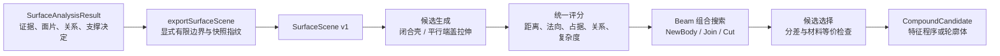

# 表面场景与实体推断

阅读位置：[五个模块总览](/modules/point-cloud-to-cad)中的“3. 特征与实体识别”。本页说明默认自动重建如何在曲面分析之后生成实体候选。曲面证据与有限面片见[解析曲面拟合](/algorithms/primitive-fitting)和[面密度与曲面展开验证](/algorithms/surface-support-validation)，模板引导与既有识别器见[特征识别与几何判定](/algorithms/feature-inference)。

实体推断不重新检测曲面、不重新分割面片、不重新估计边界。它只消费上游已经验证过的方程、有限面片、边界环和关系，生成“可能构成实体”的候选，再用观测统一评分。候选仍然不是 CAD，只有转成建模补丁并原子提交后才进入特征历史。



## 表面场景 SurfaceScene v1

导出入口是 `exportSurfaceScene()`，生产调用位于 `reconstructGuidedSolid()` 的常规分支。导出前必须通过三项前提：

- 分析结果与工作点快照匹配（`analysisMatches`），单位必须是毫米；
- 每个面片的 `surfaceId` 必须指向当前分析中的拟合曲面；
- 面片支持点必须属于当前快照。

场景头保存 `schemaVersion`、单位、分析指纹、源观测指纹、设置指纹和距离/角度容差。分析指纹与源指纹用于拒绝跨快照复用；设置指纹覆盖检测、关系与支撑验证参数。

每个 `ScenePatch` 保存：

| 字段 | 含义 |
| --- | --- |
| `id` / `surfaceId` | 本次分析快照内的面片与曲面引用 |
| `supportPointIds` | 面片支持点，保持源点 ID |
| `centroid` / `materialNormal` | 质心与材料外向法向 |
| `orientationKnown` | 材料方向是否已确定 |
| `boundaryStatus` | `ObservedClosed`、`ObservedOpen` 或 `Ambiguous` |
| `loops` | 世界坐标边界环，带外环/孔/岛角色与置信度 |
| `supportConfidence` / `residualMm` / `spacingMm` | 支撑置信度、拟合残差与采样间距 |

关系的端点只引用当前场景中的面片 ID；`manualConfirmed` 表示该关系是否由人工确认。

### 边界环如何得到

当前实现只从平面面片的已验证有限域提取边界：

1. 取支撑决定中的三角网格；
2. 统计每条无向边的使用次数，只保留使用一次的外边界边；
3. 沿边界图组装闭环；
4. 按环的嵌套深度标记 `Outer`、`Hole` 或 `Island`；
5. 按平面法向统一外环与孔环的方向。

只有“恰好一个外环，其余都是孔，且所有环闭合”的简单域才标记为 `ObservedClosed`。存在分离岛、多个外环、非简单环、缺少有限域或缺少唯一支撑决定时，面片保持 `Ambiguous`，不会在下游重新提取轮廓。

### 契约校验

`validateSurfaceScene()` 在导出末尾和推断入口各执行一次。它会拒绝：

| 错误码 | 触发条件 |
| --- | --- |
| `WrongUnit` | 场景不是毫米单位 |
| `SnapshotMismatch` | schema 版本、分析指纹或容差无效 |
| `InvalidSurfaceReference` | 面片 ID 重复、曲面引用缺失、支撑点重复、关系端点无效 |
| `MissingBoundary` | 标记为 `ObservedClosed` 却没有边界环 |
| `InvalidLoop` | 闭合环少于 3 点、开放环少于 2 点、环坐标非有限或置信度越界 |
| `MappingAmbiguous` | 面片支持点不在当前分析快照中 |

单片边界不足不会让整份场景失败，而是让该面片保持开放或歧义；只有快照、单位或 ID 破坏契约时整轮拒绝。

## 候选生成器

当前实现包含两个生成器。它们都只提案，不直接发布模型。

### 观测闭合壳

入口：`proposeObservedShell(scene, partPatches, ...)`。

接受条件：

- 至少 4 个平面面片；
- 每个面片边界为 `ObservedClosed`，材料方向已知；
- 边界的环角色只有外环和孔；
- 边界顶点按容差焊接后，边界图的每条边恰好使用两次；
- 壳体具有三个方向的正跨度。

满足条件后，实现把每个面片转换为平面的 `BoundaryFace`，用直线段构造边界，再交给 `buildProfileBody()` 做 OpenCASCADE 试建。试建失败即拒绝。该生成器不推断缺失面，也不补造未观测的边界。

### 平行端盖拉伸

入口：`proposeParallelCapExtrusion(scene, first, second, ...)`。

接受条件与产物：

| 环节 | 当前判据 |
| --- | --- |
| 端盖 | 两个平面面片，法向夹角在角度容差内 |
| 深度 | 两个平面方程的间距，必须大于距离容差 |
| 外轮廓 | 两端都有明确外环，顶点数一致，按轴向平移后最近点距离不超过 3 倍容差 |
| 通孔 | 两端内环匹配，内环可拟合为圆，且存在同轴观测圆柱壁覆盖整个拉伸深度 |
| 盲孔 | 单侧内环未匹配时，要求存在匹配的孔底环和同轴圆柱壁 |
| 外壁 | 由外环拉伸得到，标记为推断面 |

生成结果同时包含：

- 以端盖外环为截面的 `NewBody` 拉伸特征；
- 每个孔对应的 `Cut` 特征；
- 用于试建的轮廓体（含 `cavities` 或 `profileVoids`）；
- 推断侧壁记录与深度证据。

深度只来自两端平面间距，不做体积或内部点数量的盲搜。没有两端端盖时不会生成该候选。

当端盖没有孔、外轮廓由采样点围成，且所有点都落在包围盒边界上时，实现会按中位采样间距半格扩展轮廓并吸附为四角矩形。这样得到的尺寸来自观测覆盖，可能与名义尺寸相差约一个采样间距；需要精确公称尺寸时应编辑特征参数。

## 统一观测评分

入口：`scoreSolidCandidate()`。评分前先做硬校验：

- 候选未标记为拒绝，且分析指纹与场景一致；
- 评分观测的指纹与场景源指纹一致（筛选阶段可显式放宽）；
- 观测为毫米单位，容差为正；
- 候选能通过 `ModelingCore` 完成 OCCT 重建，且实体体积为正。

通过后，对全部评分观测计算：

- **距离项**：点到候选 B-Rep 外表面的 `p50` 与 `p95`，`distanceError = (p50 + 2·p95) / (3·容差)`；
- **法向项**：点方向已知且落在面内时，比较模型外法向与观测法向；
- **占据冲突**：点到模型距离大于 10 倍容差且被实体分类器判为内部时计数；
- **关系项**：候选支持面片中已有的平行、共面、垂直关系，按置信度或人工确认加权；
- **复杂度项**：`0.05 × 支持面片数`；
- **推断侧壁项**：存在推断侧壁时附加 `0.2`。

总分：

```text
score = distanceError + normalError + relationError
      + complexityPenalty + inferredSideWallPenalty
      + 4 × occupancyConflicts / 观测点数
```

接受门槛：

- 观测覆盖率（距离不超过 2 倍容差的点比例）不低于 `0.90`；
- P95 距离不超过 `4 × 容差`；
- 占据冲突不超过 `max(2, 0.5% × 观测点数)`。

评分同时记录未解释点 ID（距离超过 2 倍容差）。拒绝原因写入候选诊断，不会静默丢弃。

## 组合搜索与候选选择

`inferSolids()` 先按共享观测边把闭合面片分成连通分量，生成闭合壳候选；再对平面面片两两生成平行端盖候选。随后执行有限 Beam Search：

- 默认 Beam 宽度 4、最多 3 个特征操作、最多 64 个候选；
- 只有单次 `NewBody` 特征程序进入组合基座；
- 组合时依次尝试 `NewBody`、`Join`、`Cut`，并跳过共享支持面片的组合；
- 每个组合都实际执行 OCCT 重建：`Join` 必须增加体积，`Cut` 必须减少体积，独立 `NewBody` 实体之间不得重叠；
- 相同支持面片与操作序列的候选只保留一次；
- 搜索阶段可用最多 256 个抽样点快速筛选，最终评分使用原始全量观测。

选择入口是 `selectSolidCandidate()`。候选按总分升序排列，只有 `Accepted` 候选参与。若第二名与第一名的分差小于 `0.05`，实现会重建两者的实体并比较材料：

- 体积相同且布尔交集等于整体，视为同一材料的重复表达，选择特征更少的一个；
- 材料不同则返回歧义，不强行选择。

## 输出如何进入候选

选择成功后，`reconstructGuidedSolid()` 把结果转换为 `CompoundCandidate`：

- 有特征程序时写入 `projectionPrograms`；
- 只有轮廓体时写入 `profileBodies`；
- 未解释点写入 `unresolvedPointIds`；
- `surfaceCoverage` 取观测覆盖率，`confidence` 取 `1 - score`。

客户端仍通过 `commitCompoundCandidate()` 原子提交。几何重建层的 `planSolidCandidate()` / `commitSolidCandidate()` 已提供绑定模型修订的入口，当前生产客户端尚未切换到该入口。

## 当前失效边界

- 只对平面面片生成实体；曲面面片只作为孔壁证据参与匹配，不会单独生成曲面实体。
- 缺少一个端盖的棱柱不会生成候选，因为闭合壳需要完整边界，平行端盖拉伸需要两个端盖。
- 平行端盖匹配要求两个轮廓顶点数一致；采样数不同的真实端盖可能漏配。
- 平面两两配对受候选预算截断，预算按面片顺序消耗，可能提前停止。
- 观测覆盖率按整个场景计算。多个独立部件必须由组合搜索覆盖，超过最大操作数的部件会让候选无法达到门槛。
- 常规分支没有自动回退到旧装配路径；旧路径只在离线 CLI 显式启用。

## 源码与测试

| 内容 | 路径 |
| --- | --- |
| 场景类型与校验声明 | `core/geometric_reconstruction/include/reconstruction/solid_inference/SurfaceScene.h` |
| 场景导出与契约校验 | `core/geometric_reconstruction/src/solid_inference/SurfaceSceneAdapter.cpp` |
| 候选、评分与搜索 | `core/geometric_reconstruction/include/reconstruction/solid_inference/SolidInference.h` |
| 评分与 Beam Search | `core/geometric_reconstruction/src/solid_inference/SolidInference.cpp` |
| 观测闭合壳 | `core/geometric_reconstruction/src/solid_inference/ObservedShellClosure.cpp` |
| 平行端盖拉伸与孔 | `core/geometric_reconstruction/src/solid_inference/ParallelCapExtrusion.cpp` |
| 生产入口 | `core/geometric_reconstruction/src/pipeline/guided/GuidedSolidRecognizer.cpp` |
| 回归测试 | `core/geometric_reconstruction/tests/surface_scene_test.cpp` |

测试目标为 `surface_scene_test`，覆盖快照失配、单位错误、歧义边界、六面箱体、L 形端盖、两级阶梯、多体组合、通孔与盲孔，以及真实检测器与支撑验证链路。
