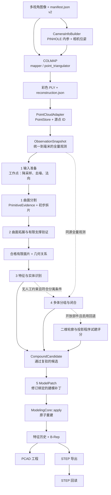

# 端到端数据流

本页沿一条真实的重建链路说明数据形态的变化：多视角图像如何变成带单位声明的点云，点云如何变成曲面证据与有限面片，识别候选如何变成特征历史与 B-Rep，最后又如何写入工程文件和 STEP。每一步的输入、输出与归属都以当前代码为准。

只看点云转模型时，可先读[五个模块总览](/modules/point-cloud-to-cad)。下图中的1–5与该主线一致；本页进一步说明数据身份和提交契约。



## 图像与相机元数据

虚拟拍摄阶段把每张图写成 PNG，并在同目录写入逐图 sidecar 与聚合 `manifest.json`。当前清单的 schema 为 `cadpc.capture.manifest`，版本常量为 2（`apps/ParamCAD Studio/src/app/CaptureController.cpp`）。v2 会为每个镜头重复保存完整相机记录，因此相机元数据在目录被移动或复制后仍然自洽；v1 清单则回退到逐图 sidecar。

`CameraInfoBuilder` 读取目录中的图像并生成 COLMAP 使用的 `CameraInfo` JSON（`apps/ParamCAD Studio/src/io/CameraInfoBuilder.cpp`）：

- 图像集合必须与目录内容一致，且至少需要两张图；
- 只接受透视投影；存在正交投影、部分图像缺少元数据或位姿不可解时，整份 `CameraInfo` 不生成，调用方直接不带 `--camera-info`，让 COLMAP 自行估计；
- 内参模型固定写为 `PINHOLE`，参数顺序为 `[fx, fy, cx, cy]`，两个焦距按输出尺寸与渲染窗口的宽高比例分别计算；
- 外参以 `camera_to_world` 的四元数与相机中心写入，相机基为 +X 向右、+Y 向下、+Z 向前。

`core/reconstruction/colmap_reconstruction/pipeline.py` 按外参覆盖程度选择重建分支：

| 分支 | 条件 | COLMAP 命令 | 清单中的相机模式 |
| --- | --- | --- | --- |
| 自动估计 | 没有 `CameraInfo` 或全部位姿缺省 | `mapper` | `estimated` |
| 全部位姿已知 | 每张图都有位姿 | 写种子模型后 `point_triangulator` | `provided` |
| 部分位姿已知 | 至少两张有位姿，其余待注册 | 先三角化，再 `mapper` 并固定已有帧 | `partial` |

无论走哪条分支，最终都输出彩色 PLY；同时在工作目录写入 `reconstruction.json`，记录引擎版本、点数、坐标系与单位。自动估计时单位为 `arbitrary`，给定位姿时继承 `--input-unit`（未指定则为 `unknown`）。

## 点云与曲面证据

客户端读取 PLY 后，先由 `PointCloudDocument` 记录源路径与源单位。单位从 PLY 相邻的 `workspace/reconstruction.json`、同目录 `reconstruction.json` 或同名 `.json` 中推断；找不到元数据的文件保持 `arbitrary`，不会被静默当作毫米（`apps/ParamCAD Studio/src/io/PointCloudMetadata.h`）。

`PointCloudAdapter::toPointStore` 把 `PlyCloud` 转成不可变 `PointStore`：

- 每个样本的 ID 取源行号加一，非有限坐标在转换时被跳过，但跳过不会让剩余点重新编号；
- 若 PLY 带法向且分量有限，则写入 `PointSample::normal`；颜色不进入几何核心；
- `PointStore` 在构造时拒绝零 ID、重复 ID、非有限坐标、越界置信度与负曲率。

`ObservationSnapshot` 只做一次统一尺度转换：已知米制输入乘以 1000 转为毫米，毫米保持不变，`arbitrary` 没有隐式换算比例；快照同时暴露源单位、转换比例与观测指纹（`core/geometric_reconstruction/include/reconstruction/data/PointStore.h`）。生产任务随后在快照上执行预处理，得到同 ID 的工作点：

1. 体素降采样，体素尺寸由稳健包围尺度或配置固定值决定；
2. 统计离群过滤，阈值使用中位数与 MAD 抑制远处噪点；
3. 缺失法向的 PCA 估计、曲率估计与方向传播，方向未确定的点保留但不参与自动建体。

模板选区的点会加入预处理保护列表，保证降采样和过滤后仍能按原 ID 找回。预处理后的工作点进入曲面分析，由 CGAL Efficient RANSAC 检测五类解析曲面，得到 `PrimitiveEvidence`。`collectSurfaceEvidence()` 在收集时拓展自动平面的支持，`indexSurfaceEvidence()` 经有限支撑验证后再重建面片和关系；内部的 `indexSurfacePatches()` 仅负责初步连通索引。

支撑验证区分工作点和原始点统计，保留验证前提案。客户端独占归属还会在原始点上补证、按冻结参考复验；拒绝域不能在显示网格或后续缓存中被重新接回。详见[曲面拓展、验证与局部修复](/modules/surface-analysis)。最终分析遵守以下身份约定：

- 证据中的 `SurfaceId` 在索引时从头重编号为 1..N；
- 每个 `SurfacePatch` 获得顺序 `PatchId`，并保存支持点 ID、范围、质心与材料法向；
- 支持点必须属于当前快照，否则索引返回 `Surface support references a different point snapshot`；
- 关系推断以面片为节点，关系端点保存的是 `PatchId`，自动关系只是假设，不强制改几何。

## 候选、特征历史与 B-Rep

识别阶段把面片与关系聚合为 `CompoundCandidate`（`core/geometric_reconstruction/include/reconstruction/recognition/CompoundRecognizer.h`）。它可同时携带长方体、多边形棱柱、贯穿孔、独立曲面实体、有限边界壳体与投影拉伸程序，并附带覆盖率、占据误差、置信度与诊断信息。此时仍没有 B-Rep，候选只是“可以尝试这样建模”的提案。

提交时由 `planCompoundCandidate` 生成 `ModelPatch`（`core/geometric_reconstruction/src/modeling/ModelingAdapter.cpp`）：

- 若调用方给出预期修订，先与当前模型修订比较，不一致立即拒绝；
- 生产提交以 `replacePrevious = true` 调用，替换此前的重建特征；带手动修改的重建特征受保护，除非显式允许覆盖；
- 在模型的私有副本上按顺序追加命令，提前分配草图和依赖 ID，并确定投影布尔的目标体；
- 补丁的 `expectedRevision` 绑定到快照修订，`rebuild` 通常为真。

`ModelingCore::apply` 是唯一的正式写入点（`core/parametric_modeling/src/ModelingCore.cpp`）。它再次核对修订，顺序执行命令；任一命令失败或 `PartDocument::rebuild` 失败时，把文档恢复为执行前的副本并返回错误，修订不变。全部成功才递增修订并返回受影响的 `FeatureId` 列表。因此“识别成功”与“建模成功”是两件事，前者不保证后者。

重放完成后得到特征历史与 `TopoDS_Shape`。草图校验、OCCT 构面、布尔运算与语义面解析都在建模层完成；几何重建层只通过 `ModelPatch` 与建模核心交互，不持有或修改 B-Rep。

## 输出与持久化

PCAD 是客户端的版本化工程文件（`apps/ParamCAD Studio/src/io/ProjectStore.cpp`）。文件以 8 字节魔数 `PCADPRJ1` 开头，随后是长度前缀的 JSON 清单：

| 清单字段 | 内容 |
| --- | --- |
| `schema` / `version` | 固定为 `paramcad.project`，常规为版本 2；存在带 `targetBody` 的拉伸时写版本 3 |
| `features` | 完整特征历史的编码数组，保存前会在临时模型上先还原验证 |
| `view` | 相机、背景、渲染尺寸、纹理投影等视图状态 |
| `selection` | 当前选中的点 ID 列表 |
| `cloudName` / `cloudUnit` | 点云文件名与源单位 |
| `assets` | 按实际内容包含 `body.brep`、`cloud.ply`、`annotations.json`、`texture.png`，并记录名称、字节数与 SHA-256 |

重开时逐项校验 schema、版本、资源白名单、文件长度与哈希，再还原特征历史并检查 `body.brep` 的 B-Rep 有效性。版本 1、2、3 都可读，保证旧工程不会因新增投影布尔目标体而失效。

STEP 导出由 `core/parametric_modeling/src/StepExporter.cpp` 调用 `STEPControl_Writer` 写出当前 B-Rep；验证入口还会回读并检查实体是否有效。客户端回读使用 `apps/ParamCAD Studio/src/io/StepModelLoader.cpp`，读入、传输根对象并校验非空形状，然后把形状平移到质心位于原点以便视口环绕（无封闭体积时改用包围盒中心）；距离与尺寸不变，原文件中的装配位置不被保留。

客户端产生的文件统一落在仓库 `outputs/` 下（`apps/ParamCAD Studio/src/app/ProjectPaths.h`）：

```text
outputs/
├── captures/<yyyyMMdd_HHmmss>/        PNG + manifest.json + 逐图 sidecar
├── reconstructions/<yyyyMMdd_HHmmss>/ cloud.ply + camera_info.json + workspace/
└── screenshots/<yyyyMMdd_HHmmss>.png  单帧视口截图
```

这条链路的边界很清楚：图像重建只对“点云与尺度”负责，几何重建只对“证据与候选”负责，建模层只对“特征历史与 B-Rep”负责，客户端负责编排和持久化。任一环节的失败都不会越过下一条边界。
