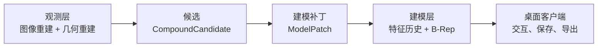

# 系统架构

本栏目从工程视角说明 Bochu Capstone 如何把“观测”变成可编辑的 B-Rep。重点不在界面操作，而在层与层之间的职责边界、数据形态和失败语义：一次重建从哪里取得输入、以什么单位与 ID 传递、在哪个环节成为正式几何、失败时又会留下什么。

架构的主线只有一条：

观测与识别层回答“点在哪里、有哪些面、构成什么特征”，建模层负责把特征参数重放成实体。数值曲面处理与CAD引擎分开；特征、部件和流程层允许临时试建复验，但不直接修改工作区模型。

## 栏目导航

| 页面 | 回答的问题 |
| --- | --- |
| [系统分层与依赖](/architecture/system-layers) | 有哪些库、客户端如何分层、第三方依赖被限制在哪里 |
| [点云转模型的代码边界](/architecture/point-cloud-code-boundaries) | 五个模块对应哪些目录、接口与数值/CAD库，兼容入口如何保留 |
| [端到端数据流](/architecture/data-flow) | 图像、点云、候选、B-Rep 与工程文件如何逐步传递 |
| [数据契约与坐标约定](/architecture/data-contracts) | 单位、点 ID、证据 ID、指纹与修订分别约束什么 |
| [后台任务与结果提交](/architecture/background-workflow) | 一次“重建 CAD”如何后台运行、取消并安全交接 |

阅读顺序建议按上表从左到右：先建立分层印象，再看数据如何流动，最后理解各类 ID 与修订为什么必须配合。

## 一条重建的完整路径

1. **采集与重建**：虚拟拍摄或真实照片经 COLMAP 生成彩色 PLY，并在 `reconstruction.json` 中声明尺度。
2. **快照与预处理**：客户端把活动点转为带稳定源点 ID 的观测快照，已知米制统一到毫米，再降采样、去噪、补法向。
3. **证据与面片**：检测解析曲面，拓展自动平面，验证有限域支撑，再生成可用于识别的面片和关系；唯一点归属由独立发布接口复验。
4. **识别与候选**：模板列表为空时，曲面分析导出 `SurfaceScene`，由实体推断生成、评分并选择候选；存在模板时走模板拟合与既有识别器。旧装配只在离线显式启用 `--legacy-assembly` 时运行，默认路径不会自动回退。
5. **计划与提交**：候选转换为修订绑定的 `ModelPatch`，由建模核心原子重放为特征历史与 B-Rep。
6. **持久化**：工程保存为 PCAD，几何可导出 STEP 并回读验证。

## 常见定位

| 想确认的问题 | 先看 |
| --- | --- |
| 某个第三方库能否跨层使用 | 系统分层与依赖 |
| 某个字段的单位或容差口径 | 数据契约与坐标约定 |
| 数据在哪一步从观测变成几何 | 端到端数据流 |
| 结果为什么被丢弃，或模型为什么没有变化 | 后台任务与结果提交 |

## 跨层约束

- **数值处理与CAD引擎分离。** Data、Input、Segmentation、Surfaces处理观测、解析证据、有限面片、关系和点归属，不链接CAD引擎。CAD上层可试建复验；正式特征历史与工作区模型由建模核心提交。所有几何核心库不依赖Qt/VTK。
- **适配边界明确。** CGAL检测结果转换为 `PrimitiveEvidence`，数值接口不暴露第三方几何类型。OCCT对象可以在CAD试建、建模和客户端I/O实现中出现，不能反向流入数值层。
- **候选不是 B-Rep。** 识别输出 `CompoundCandidate` 仍只是建模提案。只有经过 `ModelPatch` 规划并由 `ModelingCore::apply` 原子重建后，才会产生新的特征历史与 B-Rep。
- **修订先于提交。** 后台任务在工作区线程之外计算候选，结果回到工作区线程后还必须通过点云、模型与视口实体修订号的校验；任一变化都会丢弃本轮结果。

术语在本栏目内保持统一：

| 术语 | 含义 |
| --- | --- |
| 观测快照 | 仅做统一尺度转换的全量点观测，带源单位、比例与指纹 |
| 源点 ID | 由原始点云行号推导、在编辑和预处理后仍保持稳定的点标识 |
| 曲面证据 | 平面、圆柱、球、圆锥或圆环的解析拟合结果及其支持点 |
| 有限面片 | 同一曲面证据上有限且连通的支持点集合 |
| 关系 | 两个面片之间的相邻、平行、垂直、共轴等几何判定 |
| 候选 | 通过识别器验证、但尚未提交建模的实体提案 |
| 建模补丁 | 绑定模型修订、可整体成功或整体回滚的命令集合 |
| 支持点 | 曲面证据或面片所引用的源点 ID 集合 |
| 分析快照 | 一次曲面检测与索引产生的证据、面片与关系集合，指纹决定其适用范围 |
| 特征历史 | 按顺序重放的草图、拉伸、布尔与基元特征 |
| 修订 | 点云、模型或视口实体的单调版本号，用于判定结果是否过期 |
| 原子提交 | 所有命令和可选重建要么全部生效，要么文档保持原状 |

## 文档边界

- 本栏目只描述结构、数据流与契约；算法推导见“算法原理”，接口细节和操作步骤见“模块手册”。
- 具体数字、阈值与默认值以 `apps/ParamCAD Studio/config/*.conf` 和头文件默认值为准，页面不复制容易过期的参数表。
- `docs/Outdated/` 中的历史设计不作为当前实现的依据。
- 页面与代码不一致时以当前工作树为准，并在修改代码的同一提交中更新文档。

延伸阅读：数据来源与字段含义可对照 `core/geometric_reconstruction/include/reconstruction/data/PointStore.h`、`core/parametric_modeling/include/modeling/ModelPatch.h` 与 `apps/ParamCAD Studio/src/app/CadReconstructionTask.h`。
