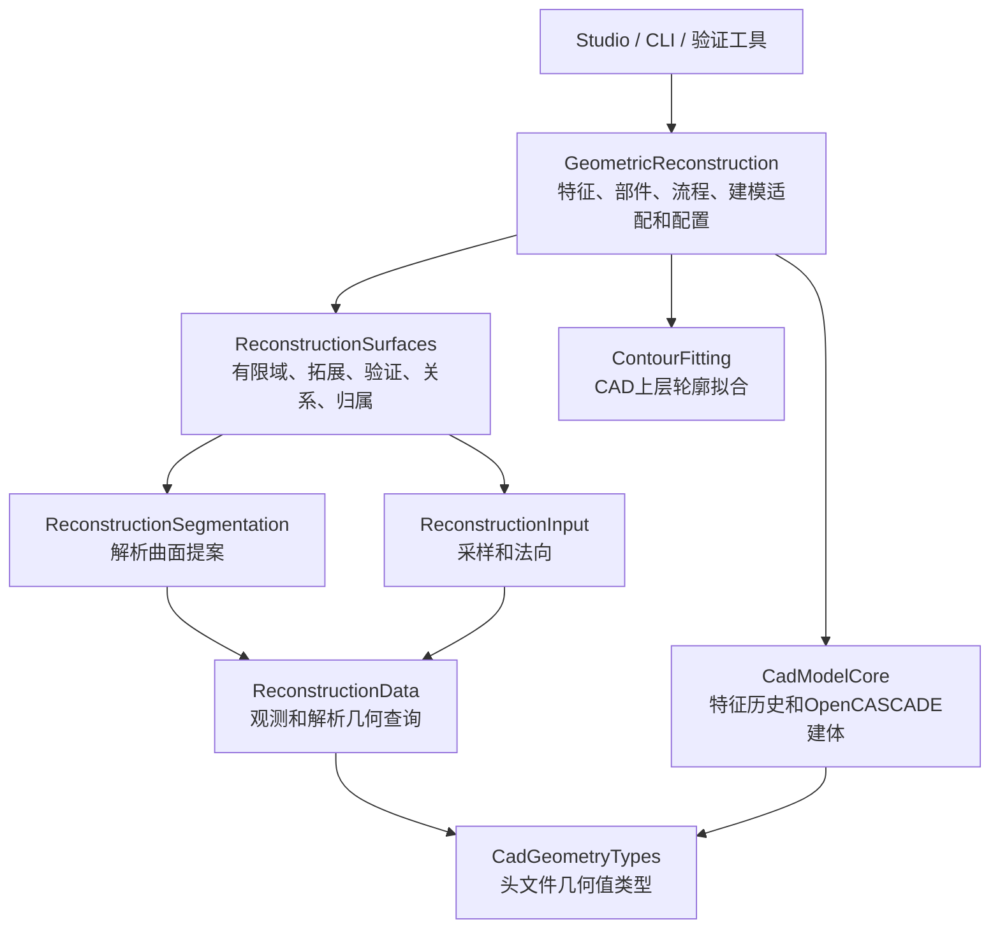

# 点云转模型的代码边界

[五个职责模块](/modules/point-cloud-to-cad)对应下面的目录。职责模块用于理解算法，CMake库用于限制编译和链接依赖；两者不要求数量相同。命名空间与现有函数签名保留，旧公开头文件路径通过兼容头转发。

## 目录与职责

以 `core/geometric_reconstruction/` 为根，公开接口位于 `include/reconstruction/`，实现位于 `src/`：

| 文档模块 | 公开接口目录 | 实现目录 | 边界 |
| --- | --- | --- | --- |
| 1. 曲面分割 | `preprocessing/`、`segmentation/` | 同名目录，检测后端在 `segmentation/cgal/` | 点、法向、曲面方程与支持点；不读取CAD实体或界面状态 |
| 2. 曲面拓展与验证 | `surface/` | `surface/`，平面生长在 `surface/expansion/` | 有限域、关系、源点补证、唯一归属和复验；不依赖Qt/VTK或CAD引擎 |
| 3. 特征与实体识别 | `recognition/` | `recognition/compound/`、`mixed/`、`curved/`等 | 判定宿主、孔、凸台及实体候选；不负责提交当前工作区 |
| 4. 多体分组与闭合 | `parts/` | `parts/assembly/`、`parts/projection/` | 部件、有限边界、闭合和投影程序；允许CAD试建复验 |
| 5. 参数化建模与交付 | `modeling/`及建模核心的 `modeling/` | 本库的 `modeling/`、`core/parametric_modeling/src/` | 候选到建模补丁的适配、特征历史与B-Rep；文件和界面适配留在客户端 |

另外三个公共职责不硬归入单一算法模块：

- `data/`保存观测、解析证据与基本几何查询。箱体、孔等候选类型归属 `recognition/FeatureCandidate.h`。
- `pipeline/`组织引导重建、识别后修复和选项策略。人工模板实现在 `pipeline/guided/`，修复事务在 `pipeline/recovery/`。
- `common/spatial/`提供内部共享空间索引；`settings/`管理配置。数值算法接收显式选项，加载识别配置的策略位于CAD上层。

## 数值层和CAD层的链接边界

箭头表示依赖方向。Data、Input、Segmentation、Surfaces不链接 `CadModelCore`，只共享其无运行时依赖的几何值类型。CGAL、Eigen和线程库按数值模块的需要私有链接。数值层不加载配置文件，不包含Qt/VTK或OCCT建体接口。

CAD特征识别、部件闭合、引导复验和建模适配目前仍共同组成 `GeometricReconstruction` 上层库：这些流程存在临时CAD试建和整体候选复验，未把它们宣称为五个互不依赖的库。客户端保留原有总链接目标 `GeometricReconstruction::GeometricReconstruction`；数值调用方可只链接 `GeometricReconstruction::Surfaces` 等目标。

来源清单统一记录在 `cmake/ReconstructionModules.cmake`，每个实现文件只有一个所属库。完整项目配置仍解析CAD SDK；单独构建数值目标不会构建CAD引擎，数值测试也不需要链接CAD运行库。

## 关键接口如何分开

| 操作 | 接口 | 重要约束 |
| --- | --- | --- |
| 提议曲面 | `segmentation/PrimitiveDetector.h` | 返回可能重叠的解析证据，不能直接当作正式面域 |
| 建立并验证分析 | `surface/SurfaceAnalysis.h`、`SurfaceSupportValidation.h` | 显式选项、同源点身份和有限域判定 |
| 发布唯一点归属 | `surface/SurfaceOwnership.h`的 `resolveSurfaceOwnership()` | 源点ID输入输出、冻结参考、有界重新分配；失败和取消不覆盖输出 |
| 单独采样或估计法向 | `preprocessing/PointCloudOperations.h` | 部件和投影不再读取预处理私有实现头；不隐式换单位或加载配置 |
| 从已有分析识别候选 | `recognition/CompoundRecognition.h` | 识别语义和候选，不提交模型 |
| 常规重建及修复 | `pipeline/ParametricReconstruction.h` | 组织分析、识别和修复事务，控制发布与回退 |
| 人工模板引导 | `pipeline/GuidedSolidRecognizer.h` | 指定类型仍须补证和边界复验 |
| 修复时查询材料 | `recognition/CandidateMaterial.h` | 流程层通过公开谓词查询，避免包含混合识别的私有数据结构 |
| 候选提交 | `modeling/ModelingAdapter.h` | 转为绑定修订的建模补丁，由建模核心原子应用 |
| 拟合平面交线与边界 | `parts/PlanarSurfaceJunctions.h` | 输入有限平面网格，返回交线段和贴合边界的独立开放面；不修改观测、不提交模型 |

原始点恢复、优先保留可靠大平面、候选竞争及归属后复验已从客户端移入 `SurfaceOwnership.cpp`。客户端 `PointCloudAnalysis.cpp`负责点云/选项适配、调用核心、源点ID到文档行的映射，以及中文名称和JSON摘要；几何归属规则由数值核心统一执行。

核心分析允许重叠证据，唯一标签是单独的发布操作。不能把一次发布丢弃的小候选从原始提案池中永久删除，也不能混用工作点和原始点的密度。

## 兼容与维护规则

旧路径 `reconstruction/detection/*`、`reconstruction/analysis/*`，以及旧的装配、投影、引导和 `CompoundRecognizer.h` 入口继续转发到新接口。仓库内部使用新路径；旧路径用于外部代码逐步迁移。保留的是源代码入口和总CMake目标，不保证脱离CMake手工链接单个旧 `.lib` 的方式仍然足够。

新增代码应遵守：

1. 分割只依赖观测、解析几何和共享数值工具；不得向曲面处理、特征或流程层反向引用。
2. 数值曲面处理不得依赖识别配置、CAD建体、客户端或Qt/VTK。
3. 跨职责调用优先使用公开接口，通用空间索引放在共享工具中。
4. GUI文档行号和 `vtkIdType` 在客户端转换；核心只接收稳定的 `PointId`。
5. 改变点、设置或面方程后重新验证；取消或错误不发布部分归属。

## 验证入口

- `surface_ownership_test`只链接数值库，验证完整面、重复候选、稀疏源ID、未归属点、off/report/enforce、取消回滚、快照和设置失效。
- `reconstruction_compatibility_test`编译并使用旧头文件入口。
- `reconstruction_boundaries_test`检查数值依赖、内部头文件迁移和实现文件所属目标，Python环境可用时自动注册到CTest。
- 现有曲面、特征、装配、投影、CAD任务、导出和CLI回归继续验证最终行为。Y373用相同点云与设置重跑，并按源点归属和面参数比较重构前结果。

### 本次迁移的本地验证记录

2026-11-18，相关14项CTest全部通过，其中包含旧入口兼容、数值归属和4条架构约束检查；另外4项原生CLI契约和9项Python分析包测试通过。数值测试程序的实际DLL依赖只有GMP及系统/C++运行库，没有Qt、VTK或OCCT运行库。

Y373以原容差3.400798重跑，仍输出703个表面、421651个已归属点。与目录重构前的 `reconstructed-support-v4.pcad-analysis` 比较：

- 全部460488个源点身份和观测数据相同。
- 点归属二进制载荷逐字节相同。
- 网格二进制载荷逐字节相同。
- 全部704条记录（含未归属）的几何类型、名称、点数、参数、残差、置信度与支撑摘要相同。
- 新包通过原生CLI的完整资产校验。

二进制比较排除48字节包头中的新快照UUID。报告位于本地 `outputs/diagnostics/module-boundaries/Y373-comparison.json`，生成资产不提交。重跑含导出约534.3秒，期间并行执行了其他验证，因此该耗时不作为独立性能基准。上述结果支持这次目录、接口与依赖迁移未改变已验证场景的行为，不代表任意未知零件都能识别正确。
