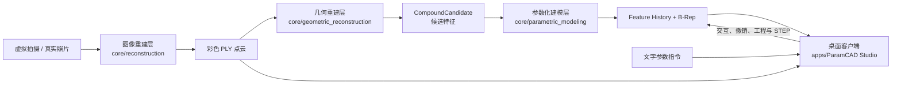

# 系统分层与依赖

## 系统总图

项目把「观测」和「建模」拆成两条互不越界的链路：上游只负责从图像或点云中提取几何证据，下游只接收结构化特征并生成 B-Rep。桌面客户端负责交互、编排和文件读写，本身不实现几何算法。

各层之间的数据交换只使用项目自有类型。CGAL、COLMAP、OpenCASCADE、VTK 等第三方类型都被限制在各自的适配边界内，不跨层暴露。

## 应用层与核心库

| 部分 | 主要职责 | 不负责的内容 |
| --- | --- | --- |
| `apps/ParamCAD Studio` | Qt 界面、控制器、文件 I/O、VTK 视口、流程编排 | 不在 UI 中实现几何算法 |
| `core/reconstruction` | 调用 COLMAP，把图片和可选相机先验转换为点云 | 不解释点云中的 CAD 语义 |
| `core/geometric_reconstruction` | 点云预处理、解析曲面证据、实体识别、生成 `ModelPatch` | 不依赖 Qt/VTK，不维护界面状态 |
| `core/parametric_modeling` | 保存特征历史、执行建模命令、重建 B-Rep、导出 STEP | 不读取图片，不运行点云检测 |
| `tools` | 批处理、契约测试、性能评测与诊断 | 不作为生产运行路径的一部分 |
| `packaging` | 收集客户端 DLL、Python 与 COLMAP，生成 Windows 安装包 | 不参与算法运行 |

桌面客户端内部再按职责分层：

- `src/app`：`MainWindow` 组合根，以及拍摄、点云、草图、建模、工程等流程控制器；
- `src/ui`：各功能面板、属性页与视口交互；
- `src/io`：STEP、PLY、CameraInfo、PCAD 等边界适配器；
- `src/rendering`：B-Rep、点云、草图到 VTK actor 的显示适配；
- `src/core`：客户端自身的场景、相机、点云文档和草图坐标逻辑。

`core/geometric_reconstruction` 与 `core/parametric_modeling` 都是 Qt/VTK 无关的静态库，可被客户端、验证程序和模块 CLI 共同链接。识别结果只有经过 `ModelingCore::apply` 原子重建后才会成为 B-Rep，识别成功不等于建模一定成功。

## 第三方依赖边界

| 依赖 | 使用层 | 边界方式 |
| --- | --- | --- |
| COLMAP 4.2.0 | 图像重建 | 仅通过 `reconstruct.py` 的命令行调用，解析其输出与数据库 |
| CGAL 6.2.1 | 几何重建 | 只在 `detection/cgal/` 私有后端出现，对外输出 `PrimitiveEvidence` |
| OpenCASCADE 8.0.1 | 建模核心、客户端 I/O | `occt/` 目录封装构面、布尔、STEP 读写；客户端持有 `TopoDS_Shape` |
| VTK 9.7.0 | 客户端显示 | 只把 B-Rep 或点云转换为渲染网格，不回写几何 |
| Qt 6 | 客户端 | 进程管理、界面、JSON 与文件操作；核心库不依赖 Qt |
| Eigen3 | 几何重建 | 数值计算支持，随 CGAL 通过 vcpkg 提供 |

约束：

- 所有 C++ 二进制依赖必须是 **MSVC 2022 + x64 + Release + dynamic CRT**，不能混用 MinGW 构建。
- `deps/` 下的 VTK、OpenCASCADE 与 COLMAP 是本地固定版本 SDK，不提交到 Git，也不参与源码检索。
- CGAL Shape Detection 采用 GPL-3.0-or-later 或商业许可；闭源分发前需要确定许可方案。

跨层调用方向是单向的：`reconstruction → geometric_reconstruction → parametric_modeling`。客户端可以调用任意下层，但下层不会反向依赖客户端类型。
