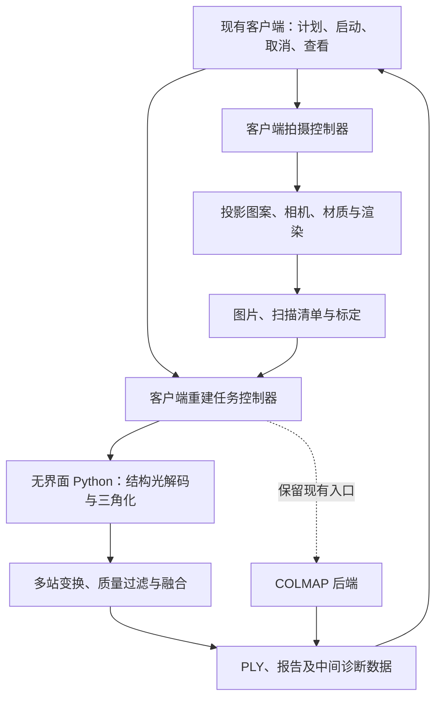
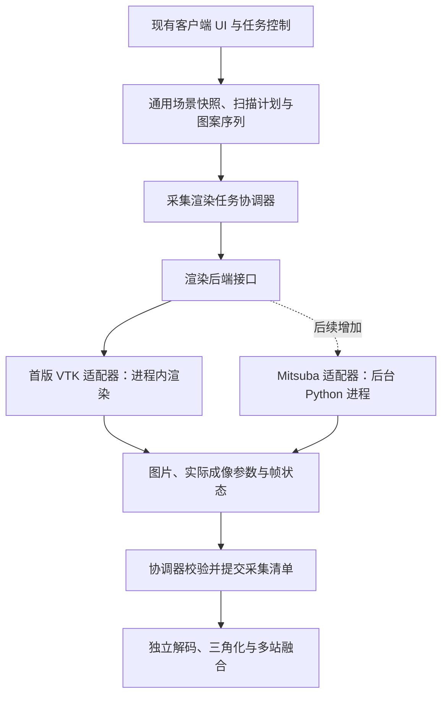

# 多视角图片转点云扩展方案

> **归档说明（2026-11-27）**：本文是早期的设计文档，计划中的能力已实现，仅保留作参考，不再作为当前实现依据。当前能力与操作说明以[结构光模块](/modules/structured-light)为准，实测结果见[结构光实现验证记录](/development/structured-light-validation)。

状态：P0–P2 的客户端闭环和 P3 相移/曝光、Mitsuba 路径追踪对照已实现；Mitsuba 3.9.1 已随离线包分发，VTK 仍为默认后端。更新日期：2026-11-13。原阶段目标保留于下文；实际能力见[模块手册](/modules/structured-light)，逐项证据与未完成项见第 10 节及[验证记录](/development/structured-light-validation)。

本文规划在现有 ParamCAD Studio 中增加主动投影重建能力。先独立跑通编码结构光的图片采集、解码、三角化和多站融合，再考虑与 COLMAP 共享位姿或融合结果。首选技术路线为单相机与单投影器组成的扫描头，先实现 Gray Code，后续增加相移条纹。

## 1. 目标与范围

### 1.1 必须满足的约束

- 扩建现有“多视角图片 → 点云”能力，保留现有普通照片与 COLMAP 入口。
- 最终所有拍摄、投影切换、重建启动、取消、日志和结果查看均由现有客户端调控。客户端可以调用无界面 Python 子进程，算法不必迁移为 C++。
- 允许独立开发 Python 程序验证算法和数据流程；原型应复用正式后端的计算函数与数据格式，不发展成第二套完整应用、独立 GUI 或用户必须手工串联的工作流。
- 当前以软件模拟拍摄为对象，模型大多为钢制金属。可以用光投射图案，不能把图案写入模型的表面颜色、UV 贴图或自发光材质来替代真实照明。
- 允许使用与实际表面相符的 PBR 材质及其贴图，描述钢材本身的颜色、金属度、粗糙度和微观法线。材质贴图与编码投影是两类独立资产，切换编码帧时不能修改模型材质。
- 正式交付必须是完整离线包：渲染与重建依赖随产品分发，用户不另装 Blender、Python、LLVM 或开发工具，不在安装、首次启动或运行任务时下载组件。选型必须评价完整运行依赖的增量体积，而不只评价渲染主程序或 wheel 的大小。
- 不依赖彩色点阵或彩色块状光斑。第一版仅使用单色明暗条纹。
- 范围截止于客户端可查看、可导出的点云，以及必要的重建质量报告。

### 1.2 本期包含与不包含的工作

| 包含 | 不包含 |
| --- | --- |
| 投影模拟、拍摄计划、图案序列、相机和投影器参数 | 点云转 STEP、参数化建模、特征识别、B-Rep |
| 图案解码、像素对应、三角化、局部深度与点云 | 为后续 CAD 处理调整或重写算法 |
| 多扫描站坐标变换、必要的配准、去除重建无效点与融合 | 第一阶段真实相机、投影器硬件驱动 |
| 客户端任务控制、产物管理、点云查看与评价 | 第一阶段多投影器同时编码、双目冗余、自动最优布站 |

多站融合属于图片转点云的一部分；它与后续点云到 CAD 的处理相互独立。

## 2. 当前基础与改动位置

以下记录扩展前的基础，用于解释接入位置；结构光新增实现不沿用普通照片的截图/纹理路径，现状见第 10 节。

| 已有部分 | 可复用能力 | 扩展要求 |
| --- | --- | --- |
| `CaptureController` | 控制 VTK 相机、输出 PNG、sidecar 和 manifest | 从“每视角一张图”扩展到“每扫描站一整组编码图” |
| `CaptureSettings`、`CapturePlan.h` | 可配置轨道拍摄，默认 62 个视角 | 新增扫描头与图案序列计划，不要求每次使用全部 62 站 |
| `CameraInfoBuilder` | 导出相机内外参并处理坐标约定 | 增加投影器标定与扫描头关系；普通照片保留原接口 |
| `ReconstructionController` | 通过 `QProcess` 调用 Python，显示日志与结果，支持取消 | 新增后端选择与通用进度协议，不再依赖 COLMAP 命令名判断新后端阶段 |
| `core/reconstruction` | 已有无界面 Python 后端与 PLY 输出 | 增加独立的结构光算法包，通过客户端调用 |
| `BodyActor` | 当前通过纹理坐标与 `SetTexture` 添加表面图案 | 该能力不作为本方案的投影照明；新增有遮挡与反射行为的投影器 |

相关现状见[虚拟拍摄与相机元数据](/modules/capture)和[COLMAP 图像重建](/modules/image-reconstruction)。当前视口的表面插值使用 Phong；钢材成像是否足够可信，应专项验证，不能把现有着色直接视为完整的钢材物理模型。

主要接入文件：

- `apps/ParamCAD Studio/src/app/CaptureController.h/.cpp`
- `apps/ParamCAD Studio/src/app/CaptureWorkspaceController.h/.cpp`
- `apps/ParamCAD Studio/src/app/CaptureSettings.h/.cpp`
- `apps/ParamCAD Studio/src/app/ReconstructionController.h/.cpp`
- `apps/ParamCAD Studio/src/io/CameraInfoBuilder.h/.cpp`
- `apps/ParamCAD Studio/src/ui/panels/CapturePanel.h/.cpp`
- `apps/ParamCAD Studio/src/ui/panels/ReconstructPanel.h/.cpp`
- `apps/ParamCAD Studio/src/ui/viewport/VTKViewer.h/.cpp`
- `apps/ParamCAD Studio/src/rendering/BodyActor.h/.cpp`
- `core/reconstruction/reconstruct.py` 与 `core/reconstruction/colmap_reconstruction/`

## 3. 技术路线与选择

| 路线 | 主要输入和原理 | 本项目安排 |
| --- | --- | --- |
| 被动多视角重建 | 普通图片中匹配自然特征，再求位姿与深度 | 保留现有 COLMAP 后端，作为独立能力和对照 |
| 随机点投影主动双目 | 同一投影状态下，双目利用人工纹理求视差 | 候选扩展；需要允许投点阵，暂不作为主线 |
| Gray Code 结构光 | 从图案序列解出相机像素对应的投影器行列，再三角化 | 第一版主线，先独立闭环 |
| Gray Code + 相移条纹 | 编码确定周期编号，相移细化周期内坐标 | Gray Code 闭环后的精度升级 |
| 激光线扫描 | 图像中的激光线与标定光平面求交 | 暂缓，需要扫描运动和独立光平面模型 |
| 偏折测量 | 分析镜面表面反射的屏幕条纹 | 针对高反光钢面的后续专项，不作为通用后备 |
| 光度立体 | 固定相机、改变光照，估计梯度和相对高度 | 暂缓，不单独承担整件绝对几何恢复 |

选择 Gray Code 是为了优先建立可解释、可逐阶段检查的闭环，并不意味着其对所有钢件均有效。工业资料明确区分非镜面表面的投影结构光与镜面表面的偏折测量。[HALCON 结构光原理](https://www.mvtec.com/doc/halcon/2511/en/toc_3dreconstruction_structuredlight.html)、[偏折测量实例](https://www.micro-epsilon.com/2d-3d-measurement/reflectcontrol)

### 3.1 最小测量单元

第一版使用一台透视相机与一台透视投影器，固定安装成扫描头。两者之间必须有非零平移基线；仅改变朝向或放在同一光心不能提供有效深度约束。

投影器视为“反向相机”：相机像素确定观察射线，解码得到的投影器像素确定投射射线，通过标定关系求三维点。相机和投影器均需内参、外参及输出尺寸。软件模拟可直接导出这些参数；未来真实设备需经标定取得，不能从 CAD 表面直接读取重建点。

OpenCV contrib 的 `structured_light::GrayCodePattern` 提供图案生成和 `getProjPixel()` 像素解码；后者可用于建立相机—投影器对应，再执行本方案的三角化。官方完整解码教程使用双相机路径，不能把该教程的 `decode()` 输出直接当作单相机—投影器三维结果。[GrayCodePattern 接口](https://docs.opencv.org/4.x/d1/dec/classcv_1_1structured__light_1_1GrayCodePattern.html)、[OpenCV 解码教程](https://docs.opencv.org/4.x/dc/da9/tutorial_decode_graycode_pattern.html)

### 3.2 采集与解码顺序

1. 将扫描头移动到一个扫描站，固定相机、投影器、模型与曝光。
2. 投射全黑、全白参考图，及横纵方向 Gray Code 正反图案；每切换一张图案，完成一次对应拍摄。
3. 用参考图和正反图差异识别阴影、低对比度及不可解码像素。
4. 对有效像素解出投影器坐标，去畸变并三角化，输出局部深度、有效掩码和点云。
5. 移动扫描头到下一站，重复完整序列。
6. 按已知扫描站位姿将局部点云变换至统一世界坐标，过滤与融合后导出最终点云。

初始配置采用完整的横纵编码，便于检查对应关系。例如投影器分辨率为 `1024 × 768` 时，正反 Gray Code 共 40 张，加全黑和全白共 42 张/相机/扫描站；这是配置示例，不是最终默认值。帧数由投影器编码分辨率决定，不由相机分辨率决定。首轮不叠加多曝光和相移，以免过早扩大采集规模。

每站内部不能移动相机或模型；站与站之间允许扫描头一起移动。因此本路线不要求全部照片共享固定的表面投影纹理，也不需要先运行 SfM。

### 3.3 多方向照射与覆盖

第一版通过移动单投影扫描头覆盖不同表面，每次只有一个编码投影源工作。若后续需要多投影器，先采用互斥分时：一台投影器完成完整序列后，再切换下一台。分时能避免多个编码源直接叠加，但不能消除单源在金属表面产生的间接反射。

先采用少量人工可检查的扫描站，再扩展为多环或针对孔槽补站。有效覆盖取决于相机与投影器共同可见、合适的三角化角度、图案对比度及曝光；“照亮面积”不能代替“可重建面积”。深孔、背面、凹腔允许保留真实缺测，不用补点掩盖失败。

## 4. 客户端与 Python 后端分工



### 4.1 客户端职责

- 选择采集模式：普通多视角拍摄或结构光扫描；根据模式提供必要参数，避免暴露不适用的 COLMAP 参数。
- 管理扫描头、扫描站计划、相机与投影器关系、图案序列及输出目录。
- 驱动投影和相机拍摄，记录每帧实际使用的参数；允许计算后端生成图案文件，但采集时序由客户端执行。
- 启动和取消重建进程，显示阶段、进度、日志及缺失参数提示；将有效结果载入已有点云视图。
- 保证同一采集任务中场景、设备关系和曝光不会被交互操作意外改变；结束或取消后恢复视口状态。

建议保留 VTK 作为交互预览与点云查看器，由客户端拥有可替换的采集渲染适配层。以现有 VTK 增加直接投影光照作为最小增量候选，以 Mitsuba 3 作为现成物理渲染候选；先验证离线依赖体积与最小场景，再选正式后端，不要求同时实现两套。Blender 仅保留为研发对照，不列入默认离线包。客户端仍拥有场景、计划、任务和产物，外部渲染器不成为另一个用户操作入口。正式采集图片必须来自被选定并记录的采集后端，不能把普通 VTK 预览截图默认为物理采集结果。具体比较和接口见第 6 节。

### 4.2 Python 职责与原型边界

建议在 `core/reconstruction/` 下新增结构光算法包，与 `colmap_reconstruction` 并列；具体包名与入口在实现时确定。第一版用 Python、NumPy 与 OpenCV contrib 验证，不要求先修改现有 COLMAP CLI 的全部接口。

Python 负责图案生成、清单校验、解码、去畸变、三角化、质量过滤、多站融合与结果写出。可以提供开发者 CLI，用于读取客户端生成或格式一致的固定测试数据，重复运行算法和比较参数。

原型不得维护另一套工程系统、场景编辑器、完整拍摄 GUI 或常驻服务。算法验证成功后，直接由客户端调用同一计算入口。正式验收不得要求用户另开终端、手工切换图案或复制中间文件。

### 4.3 渲染后端独立边界：先 VTK，后 Mitsuba

支持先实现 VTK 投影光照，再接入 Mitsuba。独立的是客户端内部的采集渲染模块与数据契约，不是另建拍摄应用；第一版不要求动态 DLL 插件系统，也不要求将 VTK 渲染移到独立进程。

原普通照片 `CaptureController` 直接持有 `VTKViewer*`，轨道采集通过 `applyCamera()`、`cameraParameters()` 和 `captureImage()` 修改并读取视口。新增结构光路径已将场景快照、计划生成、`RenderBackend` 渲染执行和 `CaptureSessionController` 产物提交拆开；`VTKViewer` 只提供一次冻结的几何数据，不承担结构光解码或图案调度。



建议由客户端采集任务协调器生成并持有不可变的 `RenderJob`，其中包含统一场景、标定、帧计划与输出约定。后端消费计划、生成图片并报告实际参数；协调器负责进度汇总、帧完整性校验、取消和最终会话状态。大型序列允许后端批处理执行，但后端不自行改变扫描站、图案顺序、曝光或重建步骤。

接口围绕以下操作定义；具体声明见 `src/capture/RenderBackend.h`，取消方法针对当前唯一活动任务，实际参数由固定任务和后端能力元数据记录：

| 操作 | 含义 |
| --- | --- |
| `capabilities()` | 声明支持的材质通道、直接/间接光照、图片格式与相机/投影器模型 |
| `validate(job)` | 在采集前检查场景、设备、格式与参数是否可表达，返回明确问题 |
| `start(job)` | 异步启动完整帧计划，复用已加载的几何与材质 |
| `cancel(jobId)` | 请求取消，由后端在安全边界停止，协调器记录未完成帧 |
| 进度、帧完成、失败及结束事件 | 报告任务 ID、帧 ID、图片路径、实际成像参数及诊断 |

通用契约只能包含网格/资产引用、变换、相机和投影器参数、PBR 通道语义、图案引用、曝光及输出定义，不能要求调用方传递 `vtkActor`、VTK 光源对象、GLSL 片段、Mitsuba 专用场景字典或其他引擎私有对象。通用帧输出描述颜色空间、响应、分辨率、实际内参和路径；不同原生图片格式由伴随元数据与固定转换适配，不让解码器猜测输入。

划分职责时保留以下边界：

- **通用部分**：扫描站与图案生成、相机/投影器几何约定、材质资产声明、采集清单、任务状态以及解码重建；不随渲染器切换重写。
- **VTK 适配器**：场景到 actor/材质的映射、投影着色器、阴影资源、帧缓冲读取和状态恢复；第一版只实现并声明直接光照能力。
- **Mitsuba 适配器**：场景到 shape/BSDF/emitter/sensor 的映射、设备坐标转换、采样与积分器、后台进程和结果读取；复用原生投影光源，不迁移 VTK 着色器代码。
- **独立的重建后端**：只读取已提交的采集清单、图片与设备参数；不调用 VTK 或 Mitsuba，也不使用它们导出的真值深度代替解码。

VTK 适配器应遵守 Qt/VTK 渲染上下文的线程归属，不能为了统一异步接口就把当前视口对象随意移入工作线程。协调器可以用事件驱动方式调度渲染帧，计算重建仍运行在独立后端。Mitsuba 适配器则可使用 `QProcess`；进程内与进程外实现共用任务语义，不要求相同执行机制。

PBR 参数具有统一语义不等于跨引擎图像完全相同。首版限定可移植的材质子集，记录粗糙度映射、法线方向和色彩空间；暂不把 VTK 私有着色器或任意 Blender 节点树作为公共材质格式。不支持的材质或成像能力须在启动前明确报错，不能静默退化后仍宣称相同物理条件。

## 5. 数据契约与任务协议

本节规定接口需求。已实现 `paramcad.structured-light.capture/calibration/result` v1，字段和目录的实际名称见[模块手册](/modules/structured-light)及 `structured_light/capture.py`。新结构光清单独立版本化，不把编码序列伪装为现有普通照片 manifest，也不把全部图案帧直接交给 COLMAP。

### 5.1 采集与重建输入

| 数据 | 必需内容 |
| --- | --- |
| 标定 | 相机、投影器 ID；各自分辨率、内参、畸变模型；扫描头内部设备变换；单位、轴向与变换方向 |
| 采集计划 | 扫描站 ID、扫描头世界位姿、图案类型/版本、编码分辨率、序列顺序、曝光设置 |
| 实际采集清单 | 图片相对路径、扫描站/相机/投影器 ID、图案 ID、编码轴、位编号、正反标志、曝光组、帧状态和标定引用 |
| 渲染场景快照 | 网格、法线、UV、材质分配、PBR 贴图及色彩空间、世界变换、环境光、投影源与相机设置；渲染引擎/版本、采样与响应设置 |

增加相移时，再增加条纹周期、相移步数和各帧相移量。图案编号不只依赖文件名排序；图案文件与生成参数需要校验标识，避免新旧图案混用。

首版采用右手世界坐标系与毫米单位；设备局部轴统一为 +X 向右、+Y 向下、+Z 向前，并显式记录 `device_to_world`。扫描头内部记录 `device_to_rig`，满足 `T_world_device = T_world_rig × T_rig_device`。相机点以同一约定变换回世界坐标。已有 COLMAP world-to-camera 表达通过适配转换，禁止猜测或重复转换。

相机内参必须匹配实际导出的图像尺寸，投影器内参必须匹配实际投影分辨率；缩放或裁剪时同步更新内参。必须区分相机光轴深度与沿观察射线距离，深度产物记录其定义，不能混合使用。

### 5.2 输出与诊断

建议产物分为原始采集会话和重建运行目录。一份采集数据可用不同参数重建多次，每次重建生成独立运行目录，不覆盖原图或其他运行。

```text
capture-session/
├── capture.json             # 新结构光实际采集清单
├── calibration.json         # 本次使用的标定快照
├── scene.json               # 采集场景、渲染参数与资产引用快照
├── assets/                  # 可复现的几何与材质资产，或受校验的缓存引用
├── patterns/                # 图案与参数记录
└── stations/                # 按扫描站组织原始图片

reconstruction-run/
├── result.json              # 新后端结果清单，引用采集会话与配置快照
├── cloud.ply                # 最终点云，必需
├── stations/                # 局部点云、深度、有效掩码、解码质量
├── diagnostics/             # 投影器坐标图、错误统计、预览
├── events.jsonl             # 任务事件
└── quality.json             # 质量评价；真值评价为可选独立步骤
```

`result.json` 至少记录：schema 版本、实际算法和版本、输入清单、参数快照、任务状态、产物路径、点数、坐标系、单位、有效站数及失败原因。渲染后端与重建后端分别记录，不把渲染引擎名称当作重建算法。此处不直接复用或改变现有 `reconstruction.json` v1 的含义；客户端先通过适配器读取不同后端结果。

最终 PLY 至少提供有限的 XYZ。RGB 可选：如需原始外观，应额外拍摄无编码图案的参考图，并明确颜色来源；不能把编码条纹颜色冒充表面原色。深度、掩码、质量及源扫描站归属保存在伴随产物中，不要求现有 PLY 查看器立即支持所有扩展属性。

### 5.3 进度、失败与取消

新后端通过 stdout 输出逐行 JSON 事件，并写入 `events.jsonl`；事件区分 `progress`、`log`、`result`、`error`，携带任务 ID，进度事件含阶段、已完成/总量。诊断文本走 stderr，避免污染事件流。现有 COLMAP 日志解析保留。

标准阶段为：输入校验、图案解码、三角化、多站融合、结果导出。客户端显示具体失败站与原因，而不只显示“重建失败”。

- 必需标定缺失、零基线、序列缺帧或图案身份不一致时，禁止静默生成正常结果。
- 第一版默认要求所选扫描站序列完整；整站不可解码与输入缺帧分别记录。结果没有有效点时失败，不把空 PLY 当作成功。
- 取消时停止继续调度，结束计算子进程，保留诊断但标记运行已取消；恢复拍摄前的场景与相机状态。
- 产物写入完成、任务退出成功且清单有效后，客户端才接管结果；不得载入上一轮产物或尚未写完的 PLY。

## 6. 投影与金属成像要求

### 6.1 投影实现的最低条件

- 图案位于光源的投影平面上，具有位置、朝向、视场、有限分辨率及亮度。
- 只照射光路可达的表面，背面和被遮挡区域不能通过纹理坐标获得图案。
- 原模型材质保持独立，成像由入射光、材质和观察方向共同决定；相机改变时允许金属反射外观变化。
- 解码输入保持一致的曝光、色调映射与响应；不要逐帧自动调亮、自动归一化，导致编码信号失真。
- CAD 几何只供场景渲染、采集规划及独立评价使用。算法输入为采集图片与设备参数，不从真值深度、网格交点或表面采样直接构造最终点云。

### 6.2 分层验证钢材行为

先用明确标记为诊断基准的漫反射模型验证投影与几何计算，再用有依据的粗糙钢面、较光亮钢面检查完整链路。诊断模型不能代替钢材验收，不以任意增大粗糙度、关闭高光或增加材质纹理的方式掩盖失败。

钢面需要关注：镜面反射导致图案不可见、饱和、遮挡、凹槽内多次反射，以及低对比度造成的误码。增加多曝光和更强的质量拒绝机制是后续工作，不保证单靠条纹就能恢复镜面钢件全部表面。工业设备也专门处理反射导致的虚假点和平面。[Zivid 反射处理说明](https://support.zivid.com/en/latest/camera/reference-articles/settings/processing-settings/reflection-filter.html)

可参考 [Accurate Structured Light Scanning Simulation](https://geometryprocessing.github.io/scanner-sim/) 的真实扫描、光传输模拟和多站融合方法。该研究对模拟与实拍一致性的主要结论针对漫反射对象，不据此推断钢面效果；作为方法参考，是否复用代码需另行评估依赖、平台与许可。

### 6.3 PBR 材质贴图与投影图案的分离

正确成像路径为：投影器发出编码光 → 光与带 PBR 材质的模型相互作用 → 相机记录反射光。模型可以有贴图，但该贴图描述材料，不直接产生条纹。表面亮暗由材质、投射光、观察方向及遮挡共同决定。

| 资产 | 用途 | 编码帧切换时的行为 |
| --- | --- | --- |
| Base Color / 材质基色 | 表面自身颜色；金属工作流中也影响反射颜色 | 固定 |
| Metallic / 金属度 | 区分金属与非金属区域 | 固定 |
| Roughness / 粗糙度 | 控制微表面反射分布 | 固定 |
| Normal / Bump | 描述划痕等微观着色细节 | 固定 |
| 编码图案 | 调制外部投影器发出的光 | 按采集计划切换 |

首版先支持基色、金属度和粗糙度的常量或图片输入，再增加法线贴图。PBR 不要求每个通道都有图片：均匀钢材可以使用常量参数。材料应对应实际零件，不能为改善重建而添加虚构的彩色图案。性能比较应区分“均匀材质”和“有真实表面细节”两组，避免用材质细节替代投影贡献。

导入贴图时记录工作流、通道打包规则、UV/映射方式与物理纹理尺度。基色按资产声明的色彩空间解码；粗糙度、金属度和法线按数据读取，不应用颜色伽马。不能默认所有 PBR 资产、法线方向或引擎参数都能无损互换。Mitsuba 的 Principled 材质支持基色、粗糙度和金属度的纹理输入，法线贴图作为独立修饰模型处理。[Mitsuba 材质与法线映射](https://mitsuba.readthedocs.io/en/stable/src/generated/plugins_bsdfs.html)

STEP 导入得到的几何不能默认包含可用的 PBR 资产；导出三角网格时需补齐材质分配与贴图坐标，保留法线，使用切线空间法线贴图时保证切线基一致。MVP 不启用真实位移：Normal/Bump 只改变着色，不等于几何发生同等变化。未来启用 Displacement 时，需同时更新渲染几何与评价真值，避免用未位移 CAD 错判误差。

### 6.4 可复用渲染引擎与推荐选择

| 方案 | 可直接复用的能力 | 仍需开发或验证的部分 | 本方案定位 |
| --- | --- | --- | --- |
| 现有 VTK 视口 | 现有交互、网格、相机与点云显示；已加入与拍摄共用的 GGX 材质预览和随相机的投影光、阴影贴图 | 视口仍是单光源直接光照，材质贴图与多次反射不在预览范围内 | 保留交互预览；视口预览与正式拍摄共用同一份着色代码与材质参数 |
| **Mitsuba 3** | 原生 `projector` 光源、透视相机、金属/Principled 材质、贴图与路径追踪；Python 调用 | 场景导出、PBR 资产映射、设备坐标转换、采样和性能验证 | **结构光物理采集的优先验证对象** |
| Blender Cycles | 现成 PBR 材质体系、材质资产调试与后台 Python 渲染 | 编码投影的光源节点/透视映射、标定一致性、场景转换和运行时体积 | 研发对照；不列入默认离线包 |

VTK 官方 PBR 示例已支持基色、ORM 和法线等纹理，因此不需要为了材质预览替换现有视口；但“开启 PBR”不能证明当前路径已正确模拟编码光与多次反射。视口材质预览只用于观察常量金属度、粗糙度与颜色的打光效果，正式成像仍以拍摄产物为准。[VTK PBR Mapping](https://examples.vtk.org/site/Cxx/Rendering/PBR_Mapping/)

Mitsuba 的 `projector` 将二维图案作为光源虚拟像平面的辐照度输入，采用与透视相机对应的像素—方向映射。这比在模型表面生成条纹更符合本项目的几何解码需求，故优先选它做小规模验证。加入间接反射时选择支持多次散射的路径追踪积分器；仅直接光照可作为分离误差来源的诊断模式，不作为钢面最终物理验证。[Mitsuba 投影光源](https://mitsuba.readthedocs.io/en/stable/src/generated/plugins_emitters.html)、[积分器说明](https://mitsuba.readthedocs.io/en/stable/src/generated/plugins_integrators.html)

Blender 的 Principled 材质体系和后台脚本能力适合已有材质资产，但接入时仍需验证编码投影，而不能把纹理接到模型的 Base Color 或 Emission 来代替光源。调用后台进程不要求用户打开 Blender 窗口；由客户端生成任务并调用脚本即可。[Blender Principled BSDF](https://docs.blender.org/manual/en/4.4/render/shader_nodes/shader/principled.html)、[后台命令行能力](https://docs.blender.org/manual/en/3.6/advanced/command_line/arguments.html)

以上其他渲染器仍属于基于官方能力的选型比较；当前项目已实现和测量的是 VTK 直接投影后端与 Mitsuba 路径追踪后端，Mitsuba 已随包分发，Blender 和 OSPRay 未集成。理想针孔投影光源不等于完整真实投影仪；散焦、镜头畸变、响应曲线与传感器噪声后续按需要建模。

### 6.5 渲染后端如何接入现有客户端

增加一个客户端拥有的采集渲染适配层，输入是第 5 节的场景快照与扫描计划，输出是图片、实际设备参数、进度和错误事件。它与“图片转点云”计算后端分离：替换渲染引擎无需重写 Gray Code 解码，替换解码算法也无需重建场景编辑入口。

任务链为：客户端确定场景与计划 → 冻结网格/PBR 资产 → 渲染适配器逐帧更新投影图案与设备位姿 → 协调器写出可核对的采集清单 → 客户端启动重建后端 → 显示点云。VTK 首版在自身所属线程中事件驱动执行；未来外部渲染器通过 `QProcess` 一次处理整个序列，复用场景。模式、站位、材质与序列参数的权威来源仍是客户端快照。

适配层负责转换引擎相机轴、投影器轴、UV/图像原点及单位，并检查导出的相机/投影器内参与实际成像一致。图案映射必须由投影器坐标决定，不能依赖模型 UV。必须记录材质资产标识、渲染引擎版本、设备、采样数、随机种子、反射深度及曝光设置；取消任务时由客户端终止渲染并将会话标记为未完成。

正式采集优先保留场景线性的浮点图像，如 EXR，客户端另生成便于查看的预览。若解码器需要整数图片，则使用全序列固定并记录的响应/量化转换，不能每帧自动增强。初始关闭可能改变细条纹的降噪和锐化，先检查采样收敛，再评估是否启用；曝光、滤波、采样噪声都应与“看起来像金属”分开验证。

### 6.6 渲染专项验收

- 固定材质，将投影器切为黑图或关闭后，编码条纹消失；材质原有细节保持存在。
- 固定模型与相机，仅移动投影器，条纹在表面的位置改变；材质贴图仍固定在模型上。
- 加入遮挡物后出现相应投影阴影，背面不会获得穿透图案；改变相机时，钢材反射外观按材质变化。
- 用已知平面检查图案方向、相机与投影器分辨率、主点和内参，排除翻转、拉伸及坐标错配。
- 用同一均匀钢材分别采集无投影和有投影图片，独立评价投影对解码与重建的贡献；不能靠新增材质纹理改善结果。
- 对同一小场景比较采样数与反射深度，检查图像及解码结果的稳定性，再记录可接受的运行成本。
- 全部任务由客户端启动、取消和查看结果；不要求用户打开外部渲染器手工配置或拍摄。

### 6.7 轻量化与完整离线分发

“无需额外安装”与“安装包小”是两个不同要求。库或可执行运行时可以随产品离线复制，不需要附带另一个安装器；但所有传递依赖、材质资产和运行库仍占用体积。当前打包已包含 Python 嵌入式运行时，版本声明为 3.13.10，可优先评估复用它，不能因此跳过二进制依赖检查。现状见 `packaging/dependencies.json` 和 `packaging/README.md`。

| 候选 | 分发形态与相对成本 | 能力边界与选择条件 |
| --- | --- | --- |
| **复用 VTK + 自定义投影光照** | 复用已有 OpenGL/VTK，增加着色器与少量自有代码，预期新增第三方运行库最少，实际体积仍需测量 | 先实现正确的直接投影、PBR 响应和阴影；不据此声称已模拟钢件多次反射 |
| **Mitsuba 3 随包部署** | 复用嵌入式 Python，随包包含 Mitsuba、Dr.Jit 及实际使用的本地运行依赖 | 原生投影光源与路径追踪减少算法模拟开发量，但需检查执行后端、体积及速度 |
| OSPRay / VTK RayTracing | C/C++ 库集成，无需完整 DCC 应用；仍有 Embree、线程等运行依赖 | 有路径追踪、PBR 材质与 VTK 接入点，但投影图案不能默认即插即用，也不能预先保证比 Mitsuba 更小 |
| Blender | 完整应用运行时 | 默认产品不携带，不要求用户自行下载或安装 |

VTK 轻量候选仍须真实计算光照：利用投影器矩阵，将可见表面点映射至图案，计算入射光和距离/方向变化，再与 PBR 反射模型及相机方向共同计算成像；用从投影器出发的深度/阴影测试拒绝遮挡区域。不能仅在最终颜色上覆盖条纹，也不能依赖模型 UV 放置编码图案。这是一种直接光照近似，可用于首先跑通流程；钢面间接反射验证需要不同能力级别的后端或进一步实现。

2026-11-12 查询 PyPI 元数据：Windows x64 / CPython 3.13 的 `mitsuba==3.9.1` wheel 为约 43.28 MiB，所依赖的 `drjit==1.5.0` wheel 为约 4.06 MiB，合计约 47.34 MiB。这仅是两份压缩 wheel 的体积，不是完整离线包或解压后运行时大小，也不包括其他算法依赖、材质资产或额外 LLVM 运行库。2026-11-13 随包实测：ZIP 增加 47.23 MiB，解压后增加 132.05 MiB，其中 Mitsuba 115.56 MiB、Dr.Jit 15.63 MiB、Mitsuba 数据 0.34 MiB。[Mitsuba 分发文件](https://pypi.org/project/mitsuba/3.9.1/#files)、[Dr.Jit 分发文件](https://pypi.org/project/drjit/1.5.0/#files)

Mitsuba 的 `scalar_rgb` 可作为不使用 LLVM JIT 的 CPU 执行候选，但吞吐量需要实测，不能用小场景可运行推断完整编码序列足够快。`llvm_ad_rgb` 使用运行时加载的 LLVM，不能遗漏该依赖，更不能要求用户在线补装。是否使用 GPU 也必须显式配置和验证，不在首次运行时自动下载 SDK。[执行后端说明](https://mitsuba.readthedocs.io/en/stable/src/key_topics/variants.html)

不承诺通过简单删除文件就能把 Mitsuba 裁剪至任意目标体积。当前官方源码构建对启用的变体有要求，定制构建须单独确认依赖、许可与运行测试，不把“只编一个 scalar 变体”写成已验证方案。[构建约束](https://mitsuba.readthedocs.io/en/stable/src/developer_guide/compiling.html)

OSPRay 提供 Principled 材质及纹理和按角度变化的光强分布，但后者不是相机标定意义下的二维针孔投影器，精细编码条纹的角度映射与采样需要适配验证。VTK 提供 `vtkOSPRayPass` 接入；当前客户端 CMake 只声明了 OpenGL 渲染组件，接入 RayTracing 仍需处理相应 VTK 模块和运行库，不能假定现有 SDK 已具备。Embree 本身是射线求交内核，若直接使用还需自行开发材质、光源和积分器，不列为现成渲染器。[OSPRay 接口](https://www.ospray.org/documentation.html)、[VTK OSPRay 接入](https://vtk.org/doc/nightly/html/classvtkOSPRayPass.html)、[Embree 示例定位](https://github.com/RenderKit/embree/blob/master/doc/src/renderer.md)

首轮增加离线选型门槛：

1. 在打包侧固定候选版本，统计完整依赖闭包、压缩增量、解压体积、资产体积和初始化耗时；不依赖目标机全局 Python、PATH 或开发环境。
2. 对同一小场景比较直接光照候选与物理渲染候选，记录图案正确性、钢面表现和整组序列耗时。先验证候选，不同时产品化两套。
3. 根据包体积预算和目标材质选正式后端；如直接光照已能满足首阶段流程验证，允许先交付该模式，明确其尚未覆盖钢面多次反射验证。
4. 复用现有完整离线打包规则，把所选运行时放入 staging，核验本地库的普通/延迟依赖、资源与许可证；保留必要运行文件，不携带完整 SDK 或开发工具。
5. 在断网、无外部渲染器和无全局 Python 的干净 Windows 环境完成客户端启动、采集、解码、取消及点云显示。缺依赖应在打包或任务启动时明确失败，不转为下载流程。

本节只修订设计与验收要求，尚未安装渲染依赖、生成候选运行时或测得最终包增量。体积预算在实测后确定，不用 wheel 大小代替验收。

### 6.8 从 VTK 升级到 Mitsuba 的改动范围

以下判断以第 4.3 节的接口与场景契约先行落实为前提，是迁移工作划分，不是工期或代码量承诺。

| 部分 | 升级时的处理 |
| --- | --- |
| 客户端扫描计划、采集入口与结果查看 | 复用；增加后端选择和能力对应的参数 |
| Gray Code/相移图案及编号 | 复用；核验新投影器的方向与像素映射 |
| 采集清单、标定、任务事件与坐标单位 | 保持公共语义；由适配器写出新后端的实际参数与来源 |
| 解码、三角化和融合 | 复用算法；依据新图像的噪声、曝光及反射行为重新验证和调整质量阈值 |
| VTK 投影着色器与阴影实现 | 保留在 VTK 后端，不移植到 Mitsuba |
| 场景与材质转换 | 新增 Mitsuba 适配，重点验证几何、UV、法线、粗糙度与反射模型 |
| 渲染任务执行 | 新增后台进程控制、批量场景复用、进度、失败和取消适配 |
| 离线打包与验证 | 新增运行库、资源、许可与干净机器验证；测量完整包增量 |
| 真实感与重建结果评价 | 重新验证；允许间接反射揭示首版未出现的失效，不要求输出逐像素或点数一致 |

这样升级属于局部但有实质工作的后端接入，不需要重做整个客户端和重建链路；主要成本是材质/成像一致性、适配器、运行依赖和验证。如果第一版继续依赖视口状态、屏幕尺寸、VTK 私有材质或渲染器导出的真值几何，后续改造会扩散到采集和算法层，无法获得上述复用范围。

首版即应完成的迁移准备：统一场景快照；与视口尺寸无关的显式成像参数；稳定图案引用；可标识的直接光照能力；独立的解码输入格式；几何与材质基准场景。新后端先通过已知平面、遮挡、材质固定而投影器移动等契约检查，再使用相同扫描计划比较多站点云。

不要求在 VTK 首版交付前实现 Mitsuba；也不要求为了未来切换同步实现全部高级材质、光学缺陷和渲染选项。首先锁定最小可移植输入、输出和任务生命周期。

## 7. 分阶段实施与验收

### P0：单站算法与投影验证

目标：先确认“图片确实能通过编码解出三维”，无需 COLMAP。

- 建立非零基线扫描头、固定参数与完整横纵 Gray Code 序列。
- 将离线运行依赖与体积评估提前至渲染选型；用 VTK 直接光照候选或 Mitsuba 3 原生投影光源验证材质与照明分离，并执行第 6.6 节的投影几何检查，再决定正式采集引擎。
- 优先由客户端最小拍摄扩展生成固定数据；允许开发用的小型生成脚本提供同格式测试输入，不建立独立采集应用。
- Python 输出解码投影器坐标、无效掩码、单站 PLY 与误差诊断。
- 检查遮挡、基线、坐标方向、尺度、分辨率与内参的一致性。

验收：在尺寸已知的诊断平面或简单模型上得到非空、尺度正确的点云；投影被遮挡处不会凭空生成图案或有效点；缺帧及零基线能明确失败。此时只通过算法可行性验证，尚未完成产品闭环。

### P1：客户端单站闭环

目标：客户端完成投影拍摄、Python 后端调用和点云查看。

- 扩展拍摄清单、结构光参数、后端选择和事件反馈。
- 先落实第 4.3 节的通用渲染任务与 VTK 适配边界，避免新增采集调度继续绑定 `VTKViewer`；此时无需实现 Mitsuba 后端。
- 客户端保存计划、生成或加载图案、执行完整拍摄、启动重建、读取并显示结果。
- 验证成功、失败、取消、重复运行及原有 COLMAP 入口。

验收：用户在同一客户端内完成一次单站重建；不执行外部命令，不手工组织图片。投影实现仍需满足第 6 节约束，打包验证包含所选渲染后端，不要求用户另行安装或下载。

### P2：客户端多站点云闭环——首个主要交付里程碑

目标：从多个扫描站的图片生成统一坐标系点云。

- 客户端调度多站完整序列，按已知位姿生成局部点云并融合。
- 固定位姿正确时直接变换，不把 ICP 作为必需步骤；后续标定有误差时再评估几何配准。
- 输出每站有效数据比例、最终点数、耗时和缺测区域，支持从原始图片重新计算。
- 使用简单诊断模型和具有代表性的钢材场景分别记录结果。

验收：同一客户端内完成“计划 → 多站拍摄 → 解码重建 → 融合 → 点云查看/导出”，没有手动文件搬运；各站尺度和坐标一致，已知距离没有镜像、倍数或轴向错误；报告明确已验证的钢材状态及未覆盖表面。本里程碑不依赖与 COLMAP 组合。

### P3：精度、材质与效率升级

- 增加 Gray Code + 相移，检查周期展开、边界误码及亚像素对应。
- 加入多曝光、饱和和低调制度拒绝、多视角质量加权，专项检查钢面间接反射。
- 根据缺测补充扫描站，再考虑减少编码帧、双目冗余和自动覆盖规划。

验收：相对于 P2，在相同场景与设备参数下报告精度、覆盖率、耗时和数据量的变化；不能只用点数增多证明质量提升。HALCON 提供 Gray Code 与相移联合生成亚像素对应的工业实现参考。[混合解码说明](https://www.mvtec.com/doc/halcon/2511/en/decode_structured_light_pattern.html)

### P4：再考虑与 COLMAP 结合

按实际瓶颈选择接入点，不默认把两套流程全部串联。

| 结合方式 | 条件与用途 |
| --- | --- |
| 共用客户端入口与结果契约 | 两条路线先独立运行；按数据类型选择后端，是最先完成的架构兼容 |
| COLMAP 提供扫描站位姿 | 未来没有可靠世界位姿时，另拍具备稳定特征的定位图片；固定扫描头标定将位姿传给结构光。必须解决尺度与坐标对齐 |
| 点云结果融合 | 两条路线都产生有效数据时，校验坐标、尺度与质量，再选择性融合 |
| 跨后端深度约束 | 只有确有需求时再研究；不是将结构光深度文件直接复制到 COLMAP 工作目录 |

不能把同一站变化的编码帧当作不同视角交给 SfM；同一位姿拍很多图案并不产生新的几何基线。纯色表面也不会因为定位图片关闭了投影就自动变得可匹配，需要实际可见且稳定的特征或外部定位依据。

## 8. 评价方式与测试重点

### 8.1 场景与指标

诊断集包括尺寸已知的平面/阶梯、立方体、圆柱、带孔槽模型；随后选取代表性的粗糙及光亮钢材。分别记录可见表面、相机与投影器共同可见表面、最终有效重建表面，避免将不可观测区域与算法失败混为一谈。

| 指标 | 评价方式 |
| --- | --- |
| 几何误差 | 重建点到参考表面的距离分布，至少给出中位数和高分位数 |
| 覆盖率 | 对参考表面按面积采样，在预先记录的距离容差内计算覆盖，避免网格顶点密度偏差 |
| 错误点比例 | 超出预先记录容差的点比例，与覆盖率同时报告 |
| 多站一致性 | 检查重叠区域的层间偏差、尺度及已知尺寸，不先对最终结果做任意拟合来隐藏位姿误差 |
| 成本 | 扫描站数、总帧数、图片体积、采集/解码/融合耗时及峰值内存 |
| 客户端可用性 | 同一任务完成率、失败原因、取消后状态恢复及产物可复现性 |

P0/P1 先验证正确性，不承诺未经测量的毫米精度；P2 基线建立后，依据目标尺寸与实际需要确定精度、覆盖率和运行时间门槛，并在比较前固定。CAD 真值评价是独立步骤，不作为解码或三角化输入。

### 8.2 优先测试

- 用合成标定与已知点验证三角化、变换方向、长度单位和相机深度定义。
- 检查正反编码、序列缺失、错误标定、尺寸不一致、阴影、饱和与低对比度。
- 通过客户端完成单站、多站、取消和失败任务，检查不会误载入历史结果。
- 复用同一采集会话重建两次，核对参数快照与产物隔离。
- 检查原普通拍摄与 COLMAP 重建流程继续可用。

## 9. 首轮开发决策

立即采用：单相机 + 单投影器、完整横纵 Gray Code、单曝光、已知扫描站位姿、单投影源逐站扫描、独立 PBR 材质与投影光源、Python 无界面算法后端、现有客户端控制、PLY 输出和完整离线分发。渲染架构保留 VTK 交互预览，以 VTK 直接投影和 Mitsuba 3 随包部署作为轻量候选与物理能力候选，先经过离线体积和成像验证再选正式后端；不把 Blender 列入默认产品依赖。

开发前优先解决三个问题：客户端渲染如何产生符合遮挡与材质行为的投影图案；相机与投影器参数如何可靠导出；每站图案序列如何被客户端调度和准确记录。它们决定图片输入是否可信，应早于复杂解码优化。

通过首轮验证再决定：正式采集引擎与运行环境、相移与多曝光配置、目标钢面范围、精度门槛、真实设备标定及 COLMAP 的具体结合方式。材质贴图规范、真实投影行为与客户端完整调控均是主要里程碑的必要条件。

## 10. 实现与验收对照（2026-11-13）

原阶段范围保持不变。下表区分已实现、已验证和后续条件项；局部通过不代表所有材料或所有阶段完成。

| 要求 | 当前实现与证据 | 尚需注意 |
| --- | --- | --- |
| P0 编码、标定、图片到点云 | `structured_light`；解析平面、独立 OpenCV 图案对照、真实 VTK 采集再解码 | 针孔、零畸变模型；不读取几何真值产生重建点 |
| P0 / §6 投影几何与材质分离 | `VtkProjectionBackend`；原生测试覆盖黑图、遮挡、背向面、投影器移动、固定材质图、观察方向和重复渲染 | 直接光照、RGB24 阴影、单次采样；非多次反射物理验证 |
| §4.3 / §6.8 后端独立 | `RenderJob`、`RenderBackend`、`CaptureSessionController`；调用方不传 VTK/GLSL 对象；`MitsubaBackend` 通过 `QProcess` 执行随包 worker | Mitsuba 已实现并随包分发，VTK 仍为默认后端；设备当前限定为零斜切、居中的方形像素针孔 |
| P1 客户端闭环 | 实际 `MainWindow`、拍摄页、重建页与点云文档集成测试 | 测试覆盖范围和本轮执行记录见验证页 |
| P2 多站与毫米尺度 | 已知扫描头位姿、双射线三角化、质量加权融合；圆柱/带孔/加强筋模型 | 深孔与未观测区域保留缺测；没有 ICP 或 CAD 补点 |
| P2 诊断和评价 | 每站深度/掩码/对应/置信度/曝光组、局部 PLY、成本报告；独立面积加权表面评价 | 参考为渲染三角网格；报告容差不等于产品精度承诺 |
| P3 相移与曝光比较 | 四步相移、三档固定曝光、饱和与低对比度拒绝；固定参数七案例对照；Mitsuba 8/32/128 spp 与反射深度 2/4/8 对照 | 光亮金属覆盖仍低；间接反射会降低加强筋凹角覆盖率（75.0%→62.4%），没有专用纠错算法 |
| §6.3 PBR | 基色/金属度/粗糙度常量与独立贴图；材质资产快照及哈希 | 法线/位移和任意材质节点按原阶段安排后置；当前箱式 UV，不是 UV 编辑器 |
| §6.7 离线分发 | 嵌入式 Python、固定 wheel 哈希、原生依赖审计、完整 full ZIP；Mitsuba/Dr.Jit 已随包并在隔离 PATH 下通过拍摄+重建冒烟 | 新包 456.88 MiB；解压/安装验证以验证页实测记录为准 |
| P4 COLMAP 兼容 | 保留普通照片入口，按采集类型选算法，禁止编码序列误入 SfM | 跨后端位姿或点云融合仍需实际需求、尺度对齐和独立验收 |

目前 VTK 仍是默认采集后端，Mitsuba 作为可选路径追踪后端随包分发；两者都已完成客户端闭环和离线包冒烟，但都不构成光亮钢件的真实光传输验证。P3 的间接反射已用 Mitsuba 补做反射深度对照，结果是覆盖率随间接反射下降而非提升，说明仍需材料与场景专项，而不是重复直接光照渲染。
