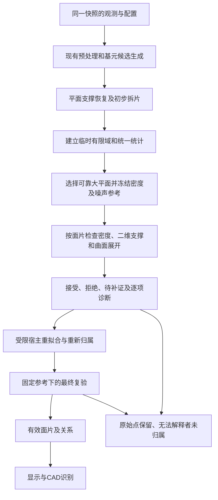

# 点云曲面支撑验证修改方案

日期：2026-11-17。状态：算法及工程接入已实现，生产数据复验结果见文末实施记录。正文保留设计时的验收口径，当前默认配置与具体行为以[算法说明](/algorithms/surface-support-validation)为准。

目标：在第一轮基元拟合之后，利用可靠大平面建立固定的面密度参考，过滤没有真实二维支撑的平面，并通过角度覆盖和可分辨弯曲量过滤近似平面的球面、圆柱面。验证结果共同约束后续点归属、显示网格和 CAD 识别。

## 1. 核心决定

1. 保留现有 RANSAC、多尺度检测和平面支撑恢复作为候选生成器，新增独立的有限面片验证阶段。
2. 验证单元是有限、连通的面片，不是无限解析方程，也不是若干不相连面片的总和。
3. 高置信度、大面积平面提供全局密度参考。一轮中固定该参考，所有待检查平面使用同一口径。
4. 平面使用密度倍数和固定尺度的内部占用检查；球面使用立体角、两个方向的角度展开；圆柱面使用绕轴的实际覆盖角度。
5. 曲面还必须具有超过噪声的弓高，并在同一组观测上优于平面拟合，才能以弯曲类型参与竞争。
6. 拒绝候选不会删除原始点。点重新参与合格候选的归属，无法解释的点保留为未归属。
7. 原始观测、拟合方程和显示网格分别保存。网格裁剪、投影或变密不能作为观测密度增加的证据。
8. 配置、验证报告和缓存签名一并修改；修复、人工引导和客户端原始点恢复也须遵守相同的验证入口。

## 2. Y373 基线与问题边界

分析包：`data/performance-validation/level-06/local/Y373/cloud.ply.pcad-analysis`。

快照 ID：`19a5c4f0-f8cc-4d20-ae24-f4ff7ea61828`。该快照单位标记为 `arbitrary`，下表距离沿用快照坐标单位。

| 对象 | 已验证的现象 | 需要解决的问题 |
| --- | --- | --- |
| Plane 262，集合 ID 262 | 41 个归属点，15 个网格顶点、17 个三角形，最长边 223.25，面积 9828.11；点主要位于边线 | 共面边线被当成有二维支撑的平面，产生跨空白的大三角形 |
| Plane 33，集合 ID 133 | 3988 个归属点，3935 个网格覆盖点，面积 144892.83 | 作为正确宿主面保留，避免因为曲面竞争被打碎 |
| Sphere 793，集合 ID 540 | 半径 2943.21，114 个归属点，球心方向最大夹角约 10.29°；只有 10 个原始非零法线 | 很浅的球冠被发布为独立球面，吸收了宿主附近的偏离点 |

平面262的边界内部检查记录为：15 个观测中 13 个靠外围边界，内部 2 点、1 个占用格，预期内部点约 12.60，最终 `rejected=false`。按当前默认设置复算，点间距约 19.13，深内部距离门槛 23.92，而网格检查位置距边界最多约 19.34，导致深内部面积为 0。

球面793的原始观测到平面33平均距离为 5.42，最小距离 3.4204；由平面记录反推的拟合容差约 3.4008。114 点全部超出该平面的既有容差。到球面的平均距离为 1.77，因此仅按逐点残差竞争会支持球面。

本方案必须同时解决“错误类型被接受”和“被拒绝后的点如何处理”。拒绝793不等于证明114个点都可以按原容差直接归回33。

上述数值来自最终快照的原始观测和缓存网格复算。快照未保存完整的检测配置和候选演化历史，不能据此断言初始 RANSAC 种子及生成顺序。

## 3. 当前接入位置

下面路径相对仓库根目录，新增文件在后文单独标注。

| 当前代码 | 现状 | 修改方向 |
| --- | --- | --- |
| `core/geometric_reconstruction/src/segmentation/cgal/CgalEfficientRansacDetector.cpp` | 默认聚类半径与整组包围盒对角线有关；同类候选可汇集不相连的支撑 | 保留候选生成，不把 RANSAC 通过当作最终有限面片通过 |
| `core/geometric_reconstruction/src/segmentation/cgal/CurvedEvidence.cpp` | 球面检查半径、距离、法线、点数 | 保留基本合法性检查；完整覆盖验证放在独立分析阶段 |
| `core/geometric_reconstruction/src/segmentation/MultiScaleDetector.cpp` | 分族生成候选，按局部区域覆盖和代价竞争 | 保留原始候选来源；最终过滤后，被拒类型不得继续占据归属资格 |
| `core/geometric_reconstruction/src/surface/expansion/PlaneSupportRecovery.cpp` | 邻域生长、重拟合和平面合并 | 候选恢复后验证；验证后的再次生长、合并必须使旧验证结果失效 |
| `core/geometric_reconstruction/src/surface/SurfaceAnalysis.cpp` | 候选收集后直接索引面片并推断关系 | 改为候选索引、建立参考、验证、重建有效面片和关系 |
| `core/geometric_reconstruction/src/surface/SurfacePatches.cpp` | 自动连通尺度由面片包围盒与点数推导 | 增加受参考间距限制的最终拆分，防止远处稀疏点撑大尺度 |
| `apps/ParamCAD Studio/src/io/PointCloudAnalysis.cpp` | 原始点恢复后重新拆片；98% 重叠抑制与逐点残差决定 UI 归属 | 在归属前验证原始点候选，归属后复验，统一使用有效候选集合 |
| `apps/ParamCAD Studio/src/rendering/PlanarSurfaceDomain.cpp` | 平面域、密度、孔洞和内部支撑逻辑集中在 Qt/VTK 客户端 | 抽取数值域构建能力到核心库，新增固定参考尺度的支撑检查 |
| `apps/ParamCAD Studio/src/rendering/PointCloudSurfaceMesh.cpp` | 共面集合联合网格化，再分回集合 | 只能消费已接受的域，禁止联合网格化重新跨接被拒绝的空白 |
| `core/geometric_reconstruction/src/surface/AnalysisSnapshot.cpp` | 缓存比较未包含本次新增设置 | 加入全部影响验证、域构建及修复的设置和算法版本 |

核心库继续保持对 Qt/VTK 无依赖。不能将正式过滤只写在渲染层，否则 CAD 识别仍可能消费错误几何。

## 4. 目标流程



“第一轮”指建立参考之前的候选拟合及临时域构建，不要求先生成完整 B-Rep。临时域只用于统计和诊断，不直接发布为识别结果。

参考只在当前快照的一轮验证中固定。换点云快照、下采样分辨率、活动点集合或关键设置时，建立新的验证上下文。

## 5. 统一统计口径与有限域

### 5.1 点数与面积

对面片 i 定义：

$$
\rho_i=N_i/A_i
$$

- `N_i`：同一快照内、位于候选有限域内且满足候选支撑要求的有效观测数。
- 依据源点身份去重，并对数值精度范围内的重复位置合并计数；不把投影到同一位置的不同真实深度层错误焊接。
- 有效原始零法线点可以由可靠邻域的几何支撑确认，不能只因没有法线而不计数；也不能把缺失法线视为已满足法线对齐。
- `A_i`：候选有限域在解析曲面上的面积，保留凹边界、孔洞和独立分量。
- `N_i` 与 `A_i` 使用同一域。整集合点数不能除以只覆盖其中一部分点的网格面积。
- 统计使用完整观测；显示网格的 `mesh_point_budget` 不得改变 `N_i`、参考值或判定结果。
- 不同候选在独占归属之前可以共享观测。同一观测不能在一个候选中重复计数。

Y373 中“3935/144892.83”与“15/9828.11”是当前缓存覆盖域的诊断口径，只用于说明密度差异。正式实现必须从新的统一有限域重新计算，不能硬编码这些数值或直接拿41替换15。

### 5.2 冻结临时域，避免循环论证

第一轮为每个面片保存 `proposal_domain`、面积 `A0`、域内点 `N0` 及支撑分布，随后执行过滤。

不能采用“发现密度低 → 缩小面积 → 密度合格 → 把原来的大面继续发布”的循环。允许将候选拆成有真实支撑的小域，但必须为这些子域建立新的判定记录，原来跨空白的大域保持拒绝。

最终发布面积为接受子域的并集，且不能重新覆盖原来拒绝的桥接区域。初始域、拒绝区域和最终域均保留可追溯的域 ID。

### 5.3 共享域构建内核

新增核心库的 `SurfaceFootprint` 数值模块：

- 输入：类型化解析方程、点 ID 与位置、有限域设置、可选参考上下文。
- 输出：二维域边界、孔洞、三角索引、覆盖点、分量、面积及支撑统计。
- 平面在局部正交坐标中处理；圆柱使用周期展开；球面采用多个局部球面图或球面三角形，处理极点和接缝。
- 面积和验证计算使用双精度及局部坐标，支持大坐标平移。
- 从现有 `PlanarSurfaceDomain.cpp` 提取可复用的数值几何，空间查询改用核心已有 KD-tree 或 CGAL；VTK 仅留在显示适配层。
- 提取阶段先保持原算法行为并验证边界、孔洞和覆盖点等价，再启用新判据，避免把重构误差混入算法评估。

## 6. 建立全局密度参考

### 6.1 可靠平面选择

候选参考必须同时满足：

1. 类型为平面，方程与残差有效。
2. 置信度达到 `density_reference_min_confidence`。该值只与平面族内部比较。
3. 点数达到 `density_reference_min_points`。
4. 在满足置信度、点数和二维支撑要求的面中，按面积降序选择大面。优先使用 `density_reference_area_quantile` 指定的大面积分位区间；若其中数量不足，仍从这个已合格集合中补足面积最大的面至 `density_reference_min_planes`。补足不降低置信度、点数或二维支撑门槛。
5. 局部观测有稳定二维分布，不能是两条远隔边线或由少数离群点撑开的包络；临时内部支撑和孔洞检查可用。
6. 同一解析面、相同观测的重复提案去重，避免同一个大面多次投票。

高置信度不能替代第5项。当前 confidence 主要受拟合残差影响，边线也可能很好地满足同一个平面方程。

### 6.2 参考计算与稳定性

若合格集合有 M 个面，选择数量为 `min(M, max(min_planes, ceil((1-area_quantile)*M)))`，面积相同时以稳定面片ID排序。这样六个可靠箱体平面不会仅因“前25%只有两个”而无法建立三面参考；若合格面本身不足三面则明确回退。

使用参考面密度的对数中位数：

$$
\rho_{ref}=\exp\{\operatorname{median}(\log\rho_i)\}
$$

每个去重后的参考面一票。暂不按面积无限加权，防止单个巨面主导整场景。记录参考面 ID、面积、点数、置信度及密度。

同时计算对数密度的稳健离散度 `1.4826 * MAD(log rho)`。参考面不足，或离散度超过配置门槛，标记参考不可用。不要通过静默降低置信度门槛或放宽倍数得到一个强行可用的参考。

参考不可用时：全局密度检查为 `NotEvaluated`，继续现有局部二维支撑检查；曲面角度验证仍运行。报告说明未执行的检查，不能宣称已完成全局密度验证。正常的纯曲面点云不应因为没有平面而整体识别失败。

### 6.3 固定尺度

定义参考间距：

$$
s_{ref}=1/\sqrt{\rho_{ref}}
$$

当前方案第一版采用严格全局参考，不自动对每个被检查面重新估计一个更宽松的参考。对天然多密度扫描，先通过参考离散度报告和禁用全局检查处理；分区参考属于后续扩展，不能在首版中隐式改变用户配置的含义。

## 7. 平面验证与跨空白约束

### 7.1 密度倍数

允许偏差量为 `plane_density_ratio_max = k`，要求有限且 `k >= 1`：

$$
1/k\leq\rho_i/\rho_{ref}\leq k
$$

低于下限记为 `PlaneDensityTooLow`，高于上限记为 `PlaneDensityTooHigh`。高密度异常同样报告，不能只实现下限而改变“偏差不能过大”的约定。

统计噪声很大的小面片使用 `support_min_expected_points` 判断分辨能力：`A_i * rho_ref` 低于门槛时，全局密度项为待补证，不凭一两个点的波动直接拒绝。它仍须通过最少点数、局部二维支撑和边界约束。

### 7.2 固定格尺度的占用检查

单个 `N/A` 仍可能被边界密集采样骗过，必须增加空间分布检查：

1. 使用参考间距确定固定网格尺度，保留每格与候选多边形的实际相交面积。
2. 对格 c，预期点数为 `lambda_c = rho_ref * area_c`。
3. 以 `1 - exp(-lambda_c)` 作为均匀独立采样下占用概率的尺度近似，累加得到预期占用格数；它是工程支撑模型，不作为精确的统计显著性声明。
4. 计算实际占用格数与预期占用格数之比，低于 `plane_min_occupied_cell_ratio` 时拒绝对应域。
5. 单独记录边界带和内部占用；只要参考尺度下存在可分辨的内部区域，就检查它，不能再由候选自己的稀疏间距使内部区域消失。
6. 真实窄条按多边形的实际相交面积计预期占用，不要求它拥有几何上不存在的大内部。

网格相位使用四种固定半格偏移，并取占用比的中位数，降低规则扫描点正好落在格边界上的敏感性。参考选择阶段的局部检查不使用尚未建立的全局量。

### 7.3 重新拆分及网格桥接

最终连通和覆盖半径可使用局部观测尺度，但受固定参考上限约束：

$$
s_{max}=\sqrt{k}\,s_{ref},\qquad
s_{used}=\min(s_{local},s_{max})
$$

连接、Alpha 半径和覆盖查询使用 `s_used` 及现有无量纲倍数。该上限限制稀疏点把局部尺度无限放大，但不代替密度和内部检查。

共面分组可以复用方程和颜色，不能以“共面”为由跨越被拒域重新网格化。联合网格只在接受域的并集内生成；已拒桥接区域应保持空白，边线原始点继续可见。

## 8. 球面和圆柱面的弯曲证据

### 8.1 量的选择

| 类型 | 主要覆盖量 | 性质 |
| --- | --- | --- |
| 球面 | `Omega = A_supported / R^2` | 立体角，无量纲；同样覆盖程度要求面积随半径平方增长 |
| 球面 | 两个主切向方向的角度展开，特别是较小方向 `theta_minor` | 排除一条很长很窄的球面带或弧线 |
| 圆柱面 | 实际连续支撑的绕轴角 `theta_effective` | 与轴向长度无关，排除长而近乎平的条带 |
| 两者 | 弓高与噪声比 `h / sigma` | 判断弯曲是否可由当前观测分辨 |

不使用 `A/R` 作为统一阈值：它有长度单位；圆柱的 `A/R = L * theta` 会被轴向长度放大。

### 8.2 球面立体角和二维展开

将有效观测沿球心方向投影到单位球，构造有实际支撑的球面域，保留孔洞和独立面片。不得用整个球壳、单个球冠凸包或所有不相连观测的总包络代替覆盖域。

球面三角形的立体角可直接在单位方向 u、v、w 上计算：

$$
\Omega_t=2\operatorname{atan2}\left(|u\cdot(v\times w)|,
1+u\cdot v+v\cdot w+w\cdot u\right)
$$

求和前要求网格朝向、接缝归属和去重一致；大三角形先细分，避免跨越错误半球。`A_supported = R^2 * sum(Omega_t)`。

小球冠在局部球面图中计算主方向角宽；使用中心90%观测的稳健宽度，降低单个远点对展开角的影响。大球面和跨半球面片采用多图覆盖，不能直接对平均径向为零的完整球面套用单个切平面。

接受球面要求：

$$
\Omega\geq\Omega_{min},\qquad
\theta_{minor}\geq\theta_{sphere,min}
$$

在固定参考尺度下缺乏二维支撑的部分不计入立体角。测得的原始法线用于辅助验证；由拟合球心推导的径向只能证明覆盖角，不能被当成独立测量法线再次增加置信度。

球面793按旧缓存网格粗算 `Omega ≈ 0.003409 sr`，约占整球的0.027%。这是新算法的核对数据，最终以新的支撑域为准。

### 8.3 圆柱绕轴角

从拟合轴构造确定性的径向基，计算每个观测的方位角 `atan2` 与轴向位置。

- 在圆周上处理0/2π接缝，不能直接使用角度数值的最大值减最小值。
- 在展开域中建立有二维支撑的角度区间；只有小于局部采样间隙门槛的空缺可以闭合。
- 对每个连通面片分别计算连续支撑角。远隔的两条母线或多个不相连条带不能相加伪装成充分展开。
- 轴向点数、长度和密度不应使一个很窄的角度区间通过。
- 对接近完整圆柱的面片，允许接缝两侧合并为接近2π的覆盖。

接受圆柱要求 `theta_effective >= cylinder_min_angular_span`。对于连续的矩形侧面，`A/(R*L)` 可以用作独立核对值；存在孔洞、轴向覆盖变化或断片时，以直接测得的角度支撑为准。

### 8.4 弓高与噪声

对圆柱使用绕轴展开角，对球面使用较小主方向展开角，计算保守弓高：

$$
h=R\left(1-\cos\frac{\min(\theta,\pi)}2\right)
$$

数值实现先对角度截断到π，再使用等价的 `2 * R * sin(theta_clamped/4)^2`，减少小角度下的消减误差。

噪声优先由可靠参考平面的有符号残差估计：对每面求 `1.4826 * MAD(signed_residual)`，再取参考面中位数。不能把“整幅弯曲面到一个平面的残差”当成噪声，否则真实曲率会抬高噪声估计。

设置 `sigma_eff = max(sigma_measured, noise_floor_fraction * fit_tolerance)`。下限是工程保护量，不能声称是已测噪声。参考不可用时使用明确记录的 `fit_tolerance / 3` 作为保守回退值。

要求 `h / sigma_eff >= curvature_min_sagitta_noise_ratio`。报告噪声估计来源和回退原因；已知扫描噪声未来可作为显式输入覆盖自动估计。

### 8.5 与平面的整体竞争

对通过覆盖和弓高检查的球面、圆柱，再与同一批观测的稳健平面拟合比较。比较样本在拟合前固定，两个模型使用相同的点、权重和噪声尺度，不能各自挑选对自己有利的内点。

建议使用明确的工程评分：

$$
C(M)=\frac1N\sum_j \operatorname{Huber}\left(r_j(M)/\sigma_{eff}\right)
+\lambda\,p_M\frac{\log N}{N}
$$

平面、球面、圆柱的解析模型自由参数分别取3、4、5；有限边界不参与自由参数计数。Huber转折点固定为1.345。该量是带复杂度惩罚的稳健评分，不称为严格的BIC。

要求 `C(plane) - C(curved) >= curved_min_model_gain`。合格独立曲面可获准归属；未显示出足够弯曲优势者标记 `PlanarAlternativePreferred`，交由宿主处理。

## 9. 候选状态、宿主处理与点归属

### 9.1 状态

每个候选面片保存汇总结论和逐项结论：

- `Accepted`：通过当前输入下所有适用的强制门槛，可参与正式归属。
- `Rejected`：存在明确失败项，不参与该解析类型的正式归属和建模。
- `NeedsMoreSupport`：观测分辨率不足，保留点和诊断，等待可用的源点补证；不可直接发布为已验证曲面。
- 单项检查另有 `NotEvaluated`，用于缺少密度参考等情况；不等同于检查通过。

人工明确指定的模板类型不被静默改成别的类型。自动候选可按本方案过滤；人工候选保留约束，验证失败时向现有人工引导调用方返回具体原因。

### 9.2 被拒曲面寻找宿主

只在附近存在接受平面、有限域相邻且几何兼容时，尝试宿主修复：

1. 从宿主邻域读取原始观测，使用固定样本集做稳健平面重拟合。
2. 不只在球面旧归属点上拟合；必须包含宿主的独立支撑，防止局部偏离点拖动大面。
3. 约束宿主原有可靠点的误差、平面转角和位移，不超过现有修复约束及拟合容差。
4. 新方程仍以原拟合容差判断可归回的点，禁止自动增大全局容差来容纳全部偏离点。
5. 重新计算域、密度、支撑与关系；不合格则回退宿主修改。
6. 没有合格宿主时，保留为未归属点；不把“拒绝球面”直接翻译成“接受平面”。

### 9.3 两次验证与有界修复

第一道验证发生在独占归属之前，避免错误类型先拿走点后再影响平面密度。归属后必须对最终独占点和有限域做一次复验，避免合格候选失去大部分支撑后仍保留大面。

参考在两道验证及修复中不变。最终复验失败的候选先移除，释放点进行有界的重新归属；候选集合只减不增。宿主重拟合最多一轮；最后再次复验，仍失败则回退修改并释放无法解释的点，不再启动同一组点的候选生成循环。

诊断同时保存归属前和归属后的统计，区分“候选没有足够支撑”和“与其他候选竞争后支撑不足”。未归属点数可能增加，不能将未归属点增加单独作为算法退化结论。

## 10. 配置和超参数

所有数值均为首轮实验起点，尚未经过Y373及正常样本的参数标定，不能作为已证明的最佳默认值。正式启用前按第14节验证并冻结默认配置。

### 10.1 用户主要调节项

| 配置键 | 实验起点 | 含义 |
| --- | --- | --- |
| `support_validation_mode` | 开发期 `report`，验收后 `enforce` | `off`保持旧行为；`report`计算但不改变结果；`enforce`应用过滤 |
| `plane_density_ratio_max` | 4 | 面密度允许相对参考上下偏差4倍 |
| `sphere_min_solid_angle_sr` | 0.02 | 球面最少支撑立体角，范围大于0且不超过4π |
| `sphere_min_minor_angular_span_deg` | 10 | 球面较小主方向的最少展开角 |
| `cylinder_min_angular_span_deg` | 20 | 圆柱绕轴最少连续支撑角 |
| `curvature_min_sagitta_noise_ratio` | 3 | 弓高至少为有效噪声尺度的3倍 |

### 10.2 参考和高级设置

| 配置键 | 实验起点 | 含义 |
| --- | --- | --- |
| `density_reference_min_confidence` | 0.8 | 参考平面最低置信度；被检查平面不受此门槛限制 |
| `density_reference_min_points` | 200 | 参考平面最少有效点 |
| `density_reference_area_quantile` | 0.75 | 在满足其他参考条件的平面中选面积前25% |
| `density_reference_min_planes` | 3 | 去重后最少参考面数量 |
| `density_reference_max_log_spread` | 0.5 | 对数密度稳健离散度上限，使用自然对数 |
| `support_min_expected_points` | 12 | 全局密度及占用检查所需的最低期望分辨能力 |
| `support_grid_spacing_multiplier` | 2 | 占用网格边长与参考间距之比 |
| `plane_min_occupied_cell_ratio` | 0.5 | 实际与预期占用格数最低比例 |
| `curvature_noise_floor_tolerance_fraction` | 0.1 | 噪声尺度下限占拟合容差的比例 |
| `curved_model_complexity_weight` | 1 | 整体模型竞争的复杂度惩罚系数 |
| `curved_min_model_gain` | 0.05 | 曲面相对平面的最低评分改善 |

角度在配置和界面中使用度，核心结构统一使用弧度；面积参考使用分位数，避免毫米制和任意单位混用的固定面积阈值。配置值必须有限且通过范围校验，`k < 1`、负立体角、无效分位数等应明确报错。

已有最少点数、局部覆盖、Alpha及修复约束尽量复用，不另建一套同义超参数。高级项在界面单独分组，主要项放在“面密度与曲面展开验证”。

## 11. 数据结构和接口

新增类型，名称为拟议接口，实施时保持职责一致：

```cpp
enum class SupportValidationMode { Off, Report, Enforce };
enum class SupportVerdict { Accepted, Rejected, NeedsMoreSupport };
enum class SupportCheckState { Passed, Failed, NotEvaluated };

struct SurfaceSupportValidationOptions; // 配置表中的全部算法设置
struct SurfaceFootprint;                // 域、孔洞、分量及数值网格
struct SurfaceSamplingReference;        // 参考面、密度、噪声及有效状态
struct SurfaceSupportDecision;          // 稳定候选/面片ID、指标、逐项结果
struct SurfaceSupportValidationReport;  // 版本、输入签名、参考和所有判定

bool validateSurfaceSupport(
    const PointStore& observations,
    const std::vector<PrimitiveEvidence>& proposals,
    const SurfaceAnalysisOptions& options,
    SurfaceSupportValidationReport& report,
    std::string& error,
    const std::function<bool()>& cancelled = {});
```

设置和报告的纯数据类型放在独立的 `SurfaceSupportTypes.h`，验证入口再依赖分析及有限域接口，避免 `SurfaceAnalysis.h` 与验证头文件互相包含。

具体数据约束：

- `SurfaceAnalysisOptions` 内增加类型化验证设置；域构建设置也必须可签名。
- 报告记录 `validation_version`、点快照指纹、单位、分辨率、容差、随机种子、模式和配置签名。
- 原始候选ID、解析方程ID、拆分前后面片ID及最终集合ID分别记录；不能假定重新编号后的索引保持不变。
- 面片判定至少含 `A0/N0`、最终面积/点数、密度比、参考间距、占用比、立体角、角度、弓高、噪声来源、模型代价、主失败原因和全部失败项。
- `SurfaceAnalysisResult.surfaces/patches/relations` 只向正式识别暴露可用结果；被拒或待补证的原始候选放在独立诊断/候选池中，避免下游误用。
- `report`模式中保留旧输出，并明确记录“假如启用过滤会发生什么”；不能混淆诊断结论和实际生效状态。
- 关系只在最终接受面片之间重新推断，失效面片的关系引用必须清除。

失败原因至少覆盖：`MissingDensityReference`、`UnstableDensityReference`、`PlaneDensityTooLow`、`PlaneDensityTooHigh`、`InsufficientInteriorSupport`、`InsufficientTwoDimensionalSupport`、`SphereSolidAngleTooSmall`、`SphereMinorSpanTooSmall`、`CylinderAngularSpanTooSmall`、`CurvatureBelowNoise`、`PlanarAlternativePreferred`、`FinalSupportLost`。

## 12. 跨流程、缓存与导出

### 12.1 工作点与原始点

核心工作点分析与客户端原始点恢复分别持有各自的统计上下文，同一轮中绝不混用两份快照的点数、面积或密度参考。恢复到原始点之后重新验证，恢复前的 `Rejected/NeedsMoreSupport` 候选仍可保留在候选池内供原始点补证，不得只留下先前通过的候选而永久丢失小特征。

同一操作的正式 CAD 发布必须使用其实际消费的观测快照和有效验证报告。若客户端源点复验推翻了工作点候选，不能仍把旧 `result.analysis` 当作有效共享缓存提供给该操作后续建模：通过稳定来源映射使对应缓存失效并重建。原始点分析也不能冒充工作点分析覆盖其 `pointFingerprint`。

两种分辨率可能给出不同的支撑结论，报告应标明分辨率和补证过程；相同输入快照、配置和种子必须得到相同结论。客户端、CLI和CAD调用方在同一输入口径下共享验证实现。

### 12.2 修复与缓存

- `analysisSettingsMatch()` 增加全部验证设置、有限域设置和算法版本。
- 点坐标、活动点、删除状态、支持点、方程、参考集合或关键设置变化，都使对应报告失效。
- 平面生长、局部恢复、关系优化及修复事务改变几何或支撑后，执行局部重新验证；若改变参考面则重建全轮参考和报告。
- 取消时不发布半更新状态；在内存临时结果上完成后整体提交。
- 不重新定义旧 confidence 的含义。新增独立的支撑验证状态，避免置信度与面积/角度质量混为一个无法解释的标量。

### 12.3 分析包与界面

导出新增可选的 `support-validation.json` 资产，含报告版本、参考及候选判定，加入manifest大小和校验。单面元数据可增加报告引用。

保持现有 `surfaces.jsonl`、原始观测与二进制映射的语义：仅有正式集合对应其中的记录。被拒候选记录写入新增报告，不冒充有合法点映射的正式surface。旧读取器可忽略可选资产；新读取器可读取旧包并显示“未记录支撑验证”，不为旧快照补写未经记录的运行结论。

`pcad inspect show/analyze` 与Python兼容读取器补充参考密度、密度比、曲面展开及拒绝原因。查询仍默认输出统计，原始坐标仅通过已有显式有界接口输出。

面板仅增加面密度比、球面/圆柱展开和主要拒绝原因等对用户有意义的内容；工程指纹、候选池和模型代价细节进入诊断报告。原始点仍可见，被拒面不会仅因没有网格而被误显示成识别成功。

## 13. 文件修改清单

| 文件或目录 | 计划修改 |
| --- | --- |
| 新增 `core/geometric_reconstruction/include/reconstruction/surface/SurfaceFootprint.h` | 脱离客户端的有限域及面积接口 |
| 新增 `core/geometric_reconstruction/src/surface/SurfaceFootprint.cpp` | 平面、球面和圆柱的有限域数值计算；必要时按图表拆分实现文件 |
| 新增 `core/geometric_reconstruction/include/reconstruction/surface/SurfaceSupportTypes.h` | 独立的设置、参考、状态及报告数据类型，避免头文件循环依赖 |
| 新增 `core/geometric_reconstruction/include/reconstruction/surface/SurfaceSupportValidation.h` | 验证接口 |
| 新增 `core/geometric_reconstruction/src/surface/SurfaceSupportValidation.cpp` | 密度参考、面支撑与类型门槛 |
| `core/geometric_reconstruction/include/reconstruction/surface/SurfaceAnalysis.h` | 接入设置、正式结果与候选诊断 |
| `core/geometric_reconstruction/src/surface/SurfaceAnalysis.cpp` | 调整候选、验证、正式索引及关系推断的顺序 |
| `core/geometric_reconstruction/src/surface/SurfacePatches.cpp` | 最终连通尺度约束及域拆分 |
| `core/geometric_reconstruction/src/surface/AnalysisSnapshot.cpp` | 设置比较、验证版本及上下文匹配 |
| `core/geometric_reconstruction/src/surface/LocalRecovery.cpp`、`RelationOptimization.cpp`、`src/pipeline/recovery/RepairTransaction.cpp` | 几何变化后的复验及事务回退 |
| `core/geometric_reconstruction/include/reconstruction/settings/ModuleConfig.h`、`src/settings/ModuleConfig.cpp` | 配置读取、序列化、校验及界面设置模型 |
| `apps/ParamCAD Studio/config/analysis.conf` | 新增主要及高级超参数 |
| `apps/ParamCAD Studio/src/io/PointCloudAnalysis.cpp` | 原始点补证、有效候选归属、最终复验及缓存失效 |
| `apps/ParamCAD Studio/src/rendering/PlanarSurfaceDomain.cpp`、`PointCloudSurfaceMesh.cpp` | 适配共享域，不再自行放行被拒区域 |
| `apps/ParamCAD Studio/src/io/AnalysisBundleExporter.cpp`、`src/io/AnalysisBundleReader.cpp` | 可选验证报告导出和读取 |
| `tools/analysis_bundle/inspect_bundle.py` | Python兼容查询器支持新报告 |
| 核心与客户端 `CMakeLists.txt` | 注册新模块与测试，保持核心无Qt/VTK依赖 |
| 对应分析、配置、客户端与导出测试 | 增加实际几何行为和兼容性测试 |
| `docs/site/validation/analysis-export.md` 等现行文档 | 实施后更新正式参数、报告和行为说明 |

现有导出相关文件已有未提交修改。后续实施必须在其现有内容基础上小范围集成，不覆盖这些工作。不得访问或改写历史分析包来伪装新算法输出。

## 14. 验证矩阵与验收标准

### 14.1 算法测试

| 场景 | 预期 |
| --- | --- |
| 高密度完整平面、普通稀疏但均匀的平面 | 在配置的密度倍数内通过 |
| 同一平面上只有两条相隔很远的边线、L形线或外围线框 | 大包络不能成面；不能以调大的局部尺度绕过检查 |
| 真正有点支撑的窄条、小面片 | 不凭缺少“深内部”误杀；不足以作全局判定时正确标记单项未评估或待补证 |
| 带孔、开槽、凹边界平面 | 孔槽保留，面积口径一致，不能用凸包导致假低密度 |
| 同方程的远隔面片、密度不同的独立面片 | 按片判断；不能相互补足密度或跨片连接 |
| 多密度扫描、参考面不足、纯曲面点云 | 参考不可用原因明确，曲面角度验证仍运行，无空集合崩溃 |
| 轻噪平面被拟合成大半径球面 | 覆盖或噪声/模型竞争门槛拒绝弯曲类型 |
| 不同半径、相同立体角的真实球冠 | 几何覆盖项一致；噪声项按各自可分辨弯曲评估 |
| 长而很窄的球面带 | 即使面积较大也不能绕过较小方向角门槛 |
| 完整球面、跨极点球面和跨图表球面 | 立体角接近4π或真实值，不重复计面积 |
| 超长且绕轴很窄的圆柱条带 | 轴向长度不能使其通过最小绕轴角 |
| 跨0/2π接缝的真实圆柱片、接近整圆柱 | 正确识别连续角，不退化成几度或接近零 |
| 两条远隔母线或带大缺口的圆柱点集 | 不能仅按角度最大最小值或面积外包络通过 |
| 相同点云平移、旋转、换单位 | 无量纲门槛结果一致，距离、面积及密度按单位正确变换 |
| 重复点、缺法线、少量坏法线、离群远点 | 不人为增加密度、展开角或独立证据 |
| 显示预算变化、源点顺序变化、固定种子重跑 | 统计不随显示采样变化；相同身份与几何下判定可复现 |

### 14.2 流程测试

- `off`模式保持现有结果；`report`模式不改变正式几何但给出完整假设判定；`enforce`按报告过滤。
- 独占归属前通过、归属后支撑丢失的面必须复验失败，释放点且停止有界修复。
- 修改任意影响判定的超参数，使分析缓存失效；修改纯显示预算不改变验证结果。
- 局部修复、人工模板、关系优化和源点恢复不能绕过验证，也不能复活旧的拒绝区域。
- 同一输入通过核心、CLI和客户端路径时，统计及结论一致；工作/原始快照差异有明确来源。
- 新包的可选资产校验正确；旧包可读取；拒绝候选不破坏正式surface的二进制映射。
- 取消或失败后，点数、集合、关系和缓存保持提交前的一致状态。

### 14.3 Y373 验收

1. 对同一源点云、活动点和记录下的配置重跑，保存新快照及配置，不使用旧显示网格作为新结果。
2. 用旧面片的源点集合及空间域匹配新结果，不以“262/793这个编号消失”作为验收条件。
3. 旧262跨空白的两个大三角形所在域不得再被接受网格覆盖。原来合法的小支撑域允许单独保留，边线观测不删除。
4. 旧793对应区域不再被接受为缺少展开证据的大半径球面；记录具体失败项及测得的立体角/角度。
5. 旧33的可靠宿主区域保持，不出现因候选竞争造成的新碎片或大面积支撑丢失；测量宿主内点保持率、方程位移、转角及残差变化。
6. 114个旧球面点的去向全部可追踪：归回宿主、归到其他合格面或未归属。没有点丢失，也不强制114点全部归回33。
7. 汇总错误桥接面积、曲面误接受数、宿主保持率、未归属变化及运行时间，附前后对比图。

Y373完整数据只作为本地验证资产；自动测试使用小型合成场景及必要的受控摘录，避免把大体积本地点云加入仓库。

### 14.4 性能与参数标定

使用同一机器、同一输入及配置比较旧流程、`report`和`enforce`。新增支撑验证复用空间索引和域结果，避免为每个候选扫描整幅点云，也避免第二道验证重复构建未变化的域。

第一版性能目标：Y373端到端耗时增幅控制在20%以内、峰值内存增幅控制在25%以内；这是待测目标，超出时需提交阶段耗时及原因。记录参考选择、域构建、占用检查、曲面验证和重新归属的独立耗时。

参数标定至少包含Y373、正常大平面、真实小球冠、大小圆柱、孔槽平面及多密度点云。扫描密度倍数、球面立体角、圆柱展开角和弓高噪声比，优先消除跨空白成面和近似平面曲面，再衡量小真实特征的误拒绝。不能只围绕Y373单例调参。

## 15. 实施顺序与阶段交付

| 阶段 | 内容 | 可审查的交付及完成条件 |
| --- | --- | --- |
| A | 冻结基线和统计接口，提取共享有限域 | 当前孔洞/边界行为保持；输出可重复的面积、覆盖点与分量，不改变正式识别结果 |
| B | 增加参考、密度、固定占用和曲面覆盖诊断 | `report`模式完整报告Y373和合成场景；配置与签名往返正确 |
| C | 接通过滤、宿主处理、两次验证和核心结果 | 正式识别只消费合格结果；点守恒、关系和修复回退测试通过 |
| D | 原始点恢复、共享缓存与显示适配 | UI/CLI/核心在同快照下口径一致；联合网格不能重新桥接拒绝区域 |
| E | 导出、查询、参数标定和性能验证 | 新旧包兼容；Y373及正常几何验收完成；记录最终默认配置并启用`enforce` |

阶段B的诊断能力是阶段C的前置条件；不能先开启过滤，再补充无法解释拒绝原因的日志。阶段E通过后才将实验起点改为正式默认值。

## 16. 完成定义

最终交付包含：共享数值验证模块、统一配置和界面入口、有效候选与点归属处理、源点及修复复验、缓存失效、可查询的导出报告、自动行为测试和Y373前后验证结果。

判定算法完成的依据是：错误跨空白平面和缺乏展开证据的球面/圆柱不能进入正式识别，正常有支撑的面仍可接受，所有未解释观测保持可追踪，且每次接受或拒绝都能用当次快照和配置复算。

## 17. 实施记录

已实现共享有限域、固定参考密度与占用检查、球面立体角与圆柱展开角、弓高/噪声和稳健平面比较；已接入核心分析、原始点补证、归属后复验、CAD人工引导、显示、配置、缓存和分析包查询。默认启用 `enforce`，参考置信度默认值为0.7；前文参数表中的实验起点不作为运行时默认值。

实际数据复验补充了两项必要处理：

- 通过验证的大平面在其有限域和原距离容差内优先保留内部观测，防止小曲面靠逐点残差切走面内条带。面积资格由 `plane_preference_min_reference_area_fraction` 控制，默认0.1。
- 面域构建使用可靠二维支撑；最终覆盖包括域内全部有效观测，精度焊接的重复位置在密度中只计一次。未参与三角化的域内点不能因此失去归属。分离域按覆盖三角形归入对应分量。

参考稳定性使用对数密度MAD及相对中位数最大偏差的较大值；参考不足或不稳定时明确回退到局部支撑检查，避免误删多密度扫描中的真实面。没有以放宽拟合容差的方式处理旧球面793的114个点。

自动验证已通过9项相关C++测试、4项原生CLI契约和9项Python分析包测试。文档构建通过，新增数学公式已渲染。完整球面、窄球冠、完整圆柱、窄圆柱条带、孔洞、窄条、重复采样、分离域、无效圆环、取消、配置往返、部分人工种子补全及正常CAD回归均有验证覆盖。

本轮尚未取得同机同配置的旧流程耗时和内存基线，因此第14.4节的20%/25%性能目标仍待对照测量；当前阈值也不代表已完成所有真实扫描类型的参数标定。

### Y373旧候选复验

复验文件为 `outputs/diagnostics/Y373-20261117/support-validation-implementation-v2.json`，原始700个候选不重新拟合，容差3.400798。固定参考密度0.0327129，参考间距5.52892。

| 旧对象 | 测量 | 结果 |
| --- | --- | --- |
| 平面262 | 密度比0.04666，占用比0.15260 | 低于密度下限0.25及占用下限0.5，拒绝 |
| 平面33主域 | 3935个覆盖位置，密度比0.83019，占用比1.04816 | 保留主域，外围不足支撑的线尾单独报告 |
| 球面793 | 立体角0.009615 sr，低于0.02 sr；较小方向展开角也不足 | 拒绝球面类型 |

### Y373生产流程重跑

使用同一460488点源快照和容差3.400798运行实际客户端分析入口，输出 `outputs/diagnostics/Y373-20261117/reconstructed-support-v4.pcad-analysis`，完整统计和对比图分别为 `production-comparison-v4.json`、`production-comparison-v4.png`。原始快照未改动，坐标指纹一致，全部点各有且仅有一个归属记录（含未归属）。新包通过原生CLI的 `verify --full`。

- 输出703个表面，421651个点归属表面，其余38837个点保留为未归属；全流程含网格及导出约508.5秒。
- 旧33的3935个可靠网格覆盖位置中，3931个仍归属平面（99.90%），3个归属圆锥、1个未归属。主宿主是新平面24，总共4267点，与旧方程夹角约0.052°，偏移变化约0.290，平均拟合残差约0.984。旧3988个归属点中3971个仍属平面。
- 旧262两个最大桥接三角形面积分别约3493.01、2128.60；各取171个严格内部位置检查新共面网格，共342个位置均未被覆盖。这是有限采样验证，不是解析面积相交证明。原41点中22点归入其他平面，19点未归属。
- 旧793的114点均可追踪：13点归属平面、2点圆柱、43点圆锥、56点未归属，无点归属球面。圆锥仍采用现有几何检查，本次新增曲率展开门槛覆盖球面和圆柱；不能据此次结果宣称所有曲面类型的误拟合已消除。

新主平面方程略有变化，因此旧球面点中只有2点进入新宿主。未以放宽容差或强制改类型把全部114点归回平面。
