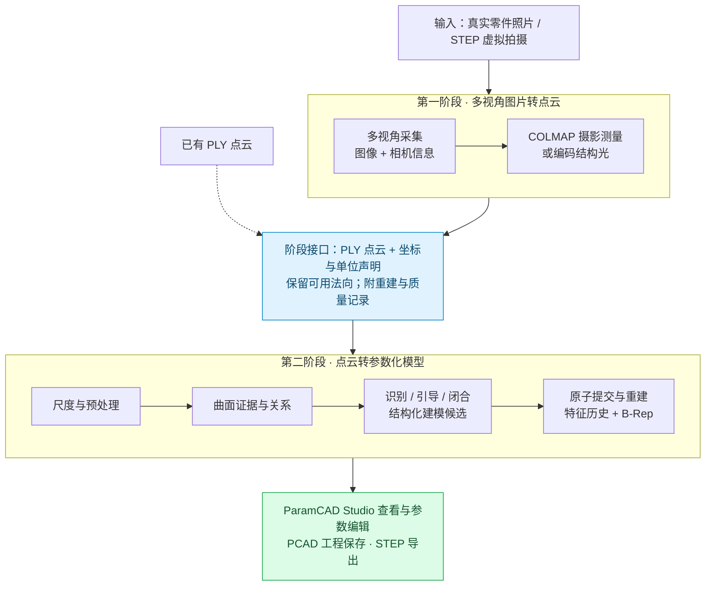
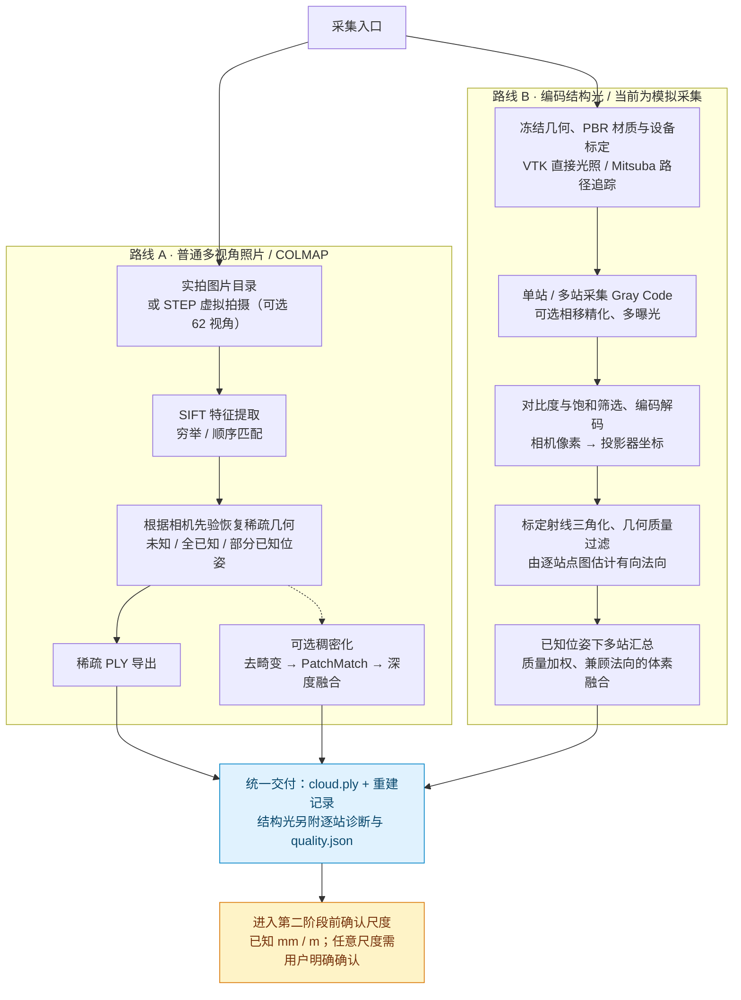
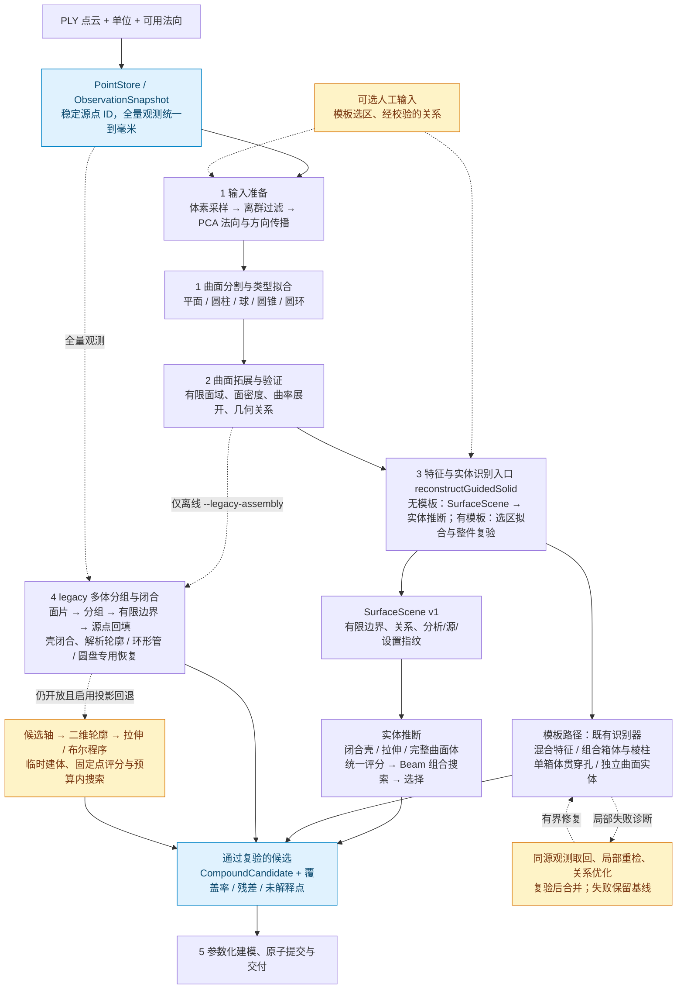
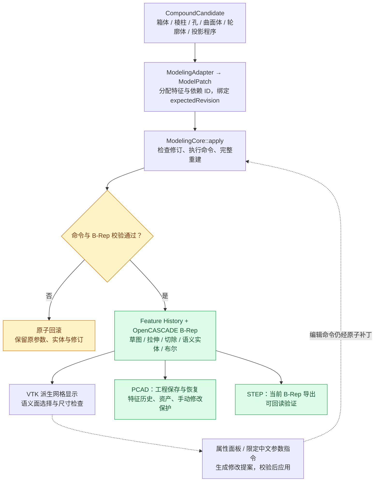

# 项目介绍

## 项目目标

Bochu Capstone（桌面客户端名为 **ParamCAD Studio**）的目标是把零件的多视角图像或点云，转换为可继续编辑的参数化 CAD，而不是只输出一个不可编辑的三角网格。

为此，项目把「观测」与「建模」拆成独立几层：图像重建层只负责从图片生成点云；几何重建层保存点、法向、曲面证据与置信度，并识别参数化特征；参数化建模层只接收结构化特征和命令，维护特征历史并重建 B-Rep；桌面客户端负责交互、编排、文件读写与显示。层与层之间只传递项目自有类型，COLMAP、CGAL、OpenCASCADE、VTK 都被限制在各自的适配边界内。

## 完整技术路线图

项目分为两个大阶段：**多视角图片转点云**解决观测和三维测量，**点云转参数化模型**解决几何解释和可编辑建模。已有 PLY 的用户可以直接从第二阶段开始。

下面的总览与细节图对应当前工作树中的实际流程。**实线表示已有处理路径，虚线表示可选输入、条件回退或编辑反馈**；虚线不代表尚未实现。后续方向单独列在[后续演进路线](#后续演进路线)，不混入现有链路。图中文字较小时，可用右上角的「＋」放大，再横向滚动查看。

<RoadmapFigure label="总览 · 从图像观测到可编辑 CAD" :width="1000">

</RoadmapFigure>

### 第一阶段：多视角图片转点云

目前有两条独立的计算路线。普通照片走 COLMAP，通过视觉特征匹配恢复几何；编码图像走结构光，通过已知投影编码建立像素对应。两者都输出点云，**当前不自动进行跨后端位姿估计或点云融合**。

<RoadmapFigure label="阶段一 · 摄影测量与编码结构光" :width="1000">

</RoadmapFigure>

| 子步骤 | 当前实现与边界 | 对应文档 |
| --- | --- | --- |
| 图像采集 | STEP 导入保留 B-Rep，VTK 虚拟拍摄写出 PNG 与相机清单；可直接使用实拍照片，尚未接入真实设备驱动。 | [虚拟拍摄与相机元数据](/modules/capture) |
| COLMAP 稀疏几何 | `reconstruct.py` 调度 `colmap_reconstruction/pipeline.py`：无位姿用 `mapper`；全位姿用 `point_triangulator`；部分位姿先三角化，再注册其余图像并固定已有帧。 | [COLMAP 图像重建](/modules/image-reconstruction) |
| COLMAP 稠密化 | 按需执行 `image_undistorter → patch_match_stereo → stereo_fusion`；自动估计相机时输出仍为任意尺度，点数增多不等于获得公制尺寸。 | [从多视角图像生成点云](/getting-started/images-to-cloud) |
| 结构光重建 | `structured_light/pipeline.py` 解码、三角化并按标定位姿融合，输出毫米点云和可用的有向法向；不读取源 CAD 真值补点。 | [编码结构光与投影拍摄](/modules/structured-light) |
| 采集质量验证 | 已有 VTK / Mitsuba 固定场景对照；反光、遮挡和凹角仍可能缺测，真实钢材光学参数、实物标定与计量验证尚待完成。 | [结构光实现验证记录](/development/structured-light-validation) |

### 第二阶段：点云转参数化模型

这一阶段按[五个模块](/modules/point-cloud-to-cad)理解：曲面分割、曲面拓展与验证、特征与实体识别、多体分组与闭合、参数化建模与交付。默认自动路径在曲面分析后进入实体推断；人工引导走模板与既有识别器；旧装配只在离线显式启用，不能把所有分支理解为每次必走的串行步骤。

<RoadmapFigure label="阶段二 · 从点云证据到建模候选" :width="1100">

</RoadmapFigure>

**现有分支各自覆盖什么：**

| 分支 | 已有实现 | 适用边界 |
| --- | --- | --- |
| 曲面分割、拓展与验证 | 五类解析曲面提案、自动平面拓展、有限域与面密度验证、球面/圆柱曲率展开验证，以及几何关系、同源补证和局部修复。 | 曲面证据不等于实体；工作点与原始点分别统计，集合归属后仍需复验。见[曲面拓展与验证](/modules/surface-analysis)。 |
| 默认实体推断 | `SurfaceScene` 导出、观测闭合壳、平行端盖拉伸、完整独立解析曲面体、通孔/盲孔切除、统一评分与 Beam 组合搜索。 | 缺盖面和曲面凸台与平面主体的混合布尔组合仍缺少通用候选来源。见[表面场景与实体推断](/algorithms/solid-inference)。 |
| 既有实体识别（模板路径） | 共享正交框架下的组合长方体与加强筋、贯穿孔、独立球 / 带端面圆柱 / 圆锥或圆台 / 完整圆环体；薄矩形宿主上的受支持凸台与通槽。 | 候选受方向、端面、材料占据和边界覆盖约束；最少箱体数只针对已检测网格。见[实体识别与人工引导](/modules/feature-recognition)。 |
| 人工引导 | 六类模板选区、人工关系确认、选区保护、局部拟合与有限 CAD 面复验。 | 人工标签不提供缺失的端面或厚度；关系必须通过观测校验。 |
| legacy 装配分离与闭合 | 有限面片分组、轮廓恢复、壳闭合，以及解析轮廓、环形管、圆盘等专用分支。 | 仅在离线 CLI 显式 `--legacy-assembly` 时运行；只提交通过验证的实体，可能保留未解释部分。见[装配分离与闭合](/modules/assembly-reconstruction)。 |
| 投影拟合回退 | 从观测截面生成基体、台阶、直槽、盲孔和贯穿孔等有限操作程序，并试建评分。 | 属于 legacy 装配的开放部件回退，默认最多 3 个操作、最多处理 6 个开放部件。见[轮廓恢复与投影拟合](/modules/projection-fitting)。 |

::: tip 分支选择以客户端任务为准
`CadReconstructionTask` 在模板列表为空时运行实体推断；存在模板时走模板拟合与既有识别器。旧装配只在离线 CLI 显式启用 `--legacy-assembly` 时运行；Studio 与在线命令不提供旧装配入口，实体推断失败也不会自动回退。其他分支也可能拒绝、保留未解释点或返回部分重建结果。
:::

### 参数化建模、编辑与交付闭环

候选通过几何识别后，还需要通过建模核心的完整重建校验。最终保存的是有类型、参数和依赖的特征历史，OpenCASCADE B-Rep 由历史重放生成。

<RoadmapFigure label="阶段二 · 从候选到可编辑工程" :width="900">

</RoadmapFigure>

实现入口位于 `core/geometric_reconstruction/src/modeling/ModelingAdapter.cpp`、`core/parametric_modeling/src/ModelingCore.cpp` 和 `PartDocument::rebuild()`。客户端编排、查看、撤销/重做与持久化连接成完整工作流；细节见[参数化建模与 B-Rep](/modules/parametric-modeling)、[桌面工作区与参数编辑](/modules/studio)和[工程保存与 STEP 导出](/modules/persistence)。

## 后续演进路线

以下为现有实现之上的演进方向，不表示已经打通，也不承诺完成时间。阶段一的测量完整度和尺度可靠性，会直接影响阶段二的识别范围与尺寸可信度。

| 大阶段 | 当前基础 | 下一步方向 | 验证重点 |
| --- | --- | --- | --- |
| 多视角图片转点云 | COLMAP 与模拟结构光各自闭环；已有相移、多曝光及 Mitsuba 对照。 | 真实相机 / 投影器标定与采集、钢材光学验证，补充带真值的真实数据。 | 同时考察几何误差、覆盖率、尺度与耗时，尤其是高光、凹角和遮挡。 |
| 多视角图片转点云 | 两个后端独立输出 PLY。 | 按扩展方案探索位姿共享与跨后端融合。 | 统一坐标和尺度、配准误差及融合收益；当前还没有自动融合链路。 |
| 点云转参数化模型 | 实体推断（闭合壳、平行端盖拉伸）、既有识别器（模板路径）、legacy 装配闭合与投影程序。 | 扩展缺盖面、曲面实体与复杂多零件候选，提高盲孔、凸台、阶梯轴和口袋等组合的适用范围。 | 保留未解释观测，区分有限分支可用与通用恢复，避免把缺面误认为实体。 |
| 点云转参数化模型 | 限定中文语法、结构化提案与原子提交。 | 自由自然语言 / LLM、歧义消解，以及文本或局部选区触发重新拟合。 | 复用修订检查、手动修改保护、完整重建校验和失败回滚。 |
| 工程持续编辑 | 会话内撤销/重做、PCAD 保存恢复、语义参照面。 | 跨会话编辑历史、通用 schema 迁移与更稳定的拓扑引用。 | 重开工程后依赖一致、旧版本兼容、上游编辑后的引用稳定。 |

后续方向详见[路线图与里程碑](/development/roadmap)和[多视角图片转点云扩展方案](/development/multiview-reconstruction-extension)。验证入口见[端到端精度与性能评测](/validation/end-to-end)与[阶段契约与回归测试](/validation/contract-tests)。

## 当前能力

- 桌面端可导入 STEP/STP 并保留原始 B-Rep，也可打开 PLY 点云；视口使用 VTK 显示由 B-Rep 派生的网格。
- 虚拟多视角拍摄支持单张、自定义环绕和 62 视角球面采样，并写出相机元数据；现实照片可直接选择图片目录，但未集成相机硬件采集。
- 图像重建通过无界面的 `core/reconstruction/reconstruct.py` 调用 COLMAP 4.2.0，支持未知、部分已知和全部已知相机参数，输出稀疏或稠密彩色 PLY。
- 编码结构光支持 VTK / Mitsuba 模拟采集、Gray Code、可选相移与多曝光，完成解码、三角化、多站融合并输出毫米点云与可用法向；真实设备接入及钢材计量验证尚未完成。
- 点云预处理包括体素降采样、离群过滤、缺失法向的 PCA 估计与方向传播，并保留源点 ID。
- 曲面检测支持平面、圆柱、球、圆锥和圆环面；默认自动重建在曲面分析后导出 `SurfaceScene`，用实体推断生成观测闭合壳、平行端盖拉伸和完整解析曲面体候选，并支持通孔与盲孔切除。模板路径仍支持组合长方体、平面加强筋、单长方体贯穿孔，以及独立曲面实体。
- 已接入受观测约束的混合特征、人工模板、局部修复，以及离线显式启用的 legacy 装配分离与闭合；默认路径不会自动回退到旧装配。这些分支的适用范围见上方细节路线。
- 参数化建模核心支持草图、拉伸、切除、长方体、贯穿孔和曲面实体，使用带 revision 检查的原子建模补丁提交，可重建 B-Rep 并导出 STEP。
- 客户端可编辑 Box 尺寸、贯穿孔直径、圆柱半径/高度，支持固定中心或指定语义面、原子应用、失败回滚，以及当前会话内最多 50 步 CAD 撤销/重做。
- 支持 `.pcad` 工程保存与恢复，以及限定中文语法的文字参数修改，例如「高度增加 2 mm，固定中心」。

**明确不支持的能力：**

- 任意机械零件的通用自动恢复；现有分离、盲孔、凸台等分支仍有几何和观测限制，缺面、遮挡及复杂孔槽组合不能普遍处理。
- 自由自然语言理解、LLM/Agent 接入，以及由文字或局部选区触发的通用重拟合；识别流程内已有受限的局部重检与修复，文字命令仍只覆盖已列出的参数修改语法。
- SolidWorks MCP 或外部 CAD 后端；当前建模后端是项目内的 OpenCASCADE 核心。
- 通用布尔结果面的稳定命名，以及对任意布尔面的持久引用。
- 跨会话撤销历史、任意工程 schema 迁移和真实 OBJ/PLY 网格解析。
- 从图片直接得到 CAD；图像重建只输出点云，语义识别由后续点云阶段完成。

## 输入与输出

| 输入 | 处理阶段 | 输出 |
| --- | --- | --- |
| STEP/STP 模型 | 客户端导入或虚拟拍摄 | 保留 B-Rep 的显示模型；多视角 PNG + 相机元数据 |
| 普通多视角图片目录 | COLMAP 图像重建 | `cloud.ply`、`workspace/reconstruction.json`，相机先验可用时另有 `camera_info.json` |
| 编码结构光采集目录 | 解码、三角化、多站融合 | `cloud.ply`、`result.json`、`quality.json` 与逐站诊断 |
| PLY 点云（可带颜色与 `nx/ny/nz` 法向） | 点云预处理与实体识别 | 参数化特征、`.pcad` 工程、STEP |
| 单位清单或 sidecar | 点云读取 | `mm`、`m` 或 `arbitrary` 尺度语义 |
| 限定中文参数指令 | 客户端文字参数修改 | 预览提案，确认后原子重建的 B-Rep |

单位约定：建模核心使用毫米；米制点云在预处理时换算为毫米。没有公制元数据的点云尺度为 `arbitrary`，重建 CAD 前必须由用户明确确认「1 个源单位 = 1 毫米」，不能静默假设。

## 推荐阅读顺序

1. [安装与构建](/getting-started/installation)：准备工具链、构建客户端，确认可执行文件与运行库的相对位置。
2. [从多视角图像生成点云](/getting-started/images-to-cloud)：只有照片时，先得到带尺度信息的 PLY。
3. [点云到 CAD 快速上手](/getting-started/first-reconstruction)：导入点云、重建、编辑并导出 STEP。
4. [系统分层与依赖](/architecture/system-layers) 与 [端到端数据流](/architecture/data-flow)：理解各层边界和数据类型。
5. [COLMAP 图像重建](/modules/image-reconstruction)、[曲面检测与证据](/modules/surface-detection)、[参数化建模与 B-Rep](/modules/parametric-modeling)：按模块深入实现细节。
