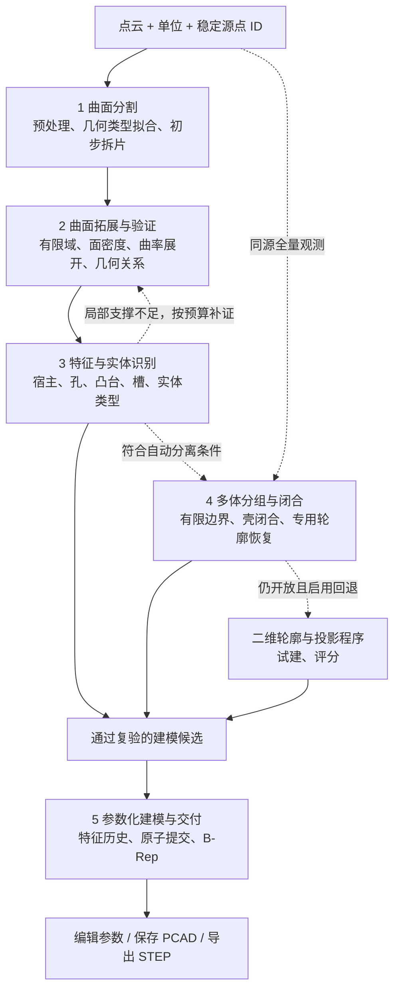

# 点云转参数化模型：五个模块

从点云到可编辑 CAD，可以按五个问题理解：**点属于哪些面？面应拓展到哪里？这些面构成什么特征？哪些面属于同一个实体？怎样生成可编辑模型？** 下面按这些职责组织现有实现，具体接口和阈值放在对应模块及算法页。

对应的本地目录、公开接口和库依赖见[点云转模型的代码边界](/architecture/point-cloud-code-boundaries)。

## 先看整体流程

| 模块 | 回答的问题 | 主要产物 | 继续阅读 |
| --- | --- | --- | --- |
| 1. 曲面分割 | 哪些点支持同一个面？它是平面、圆柱还是其他解析曲面？ | 曲面方程、支持点和初步连通面片 | [预处理](/modules/preprocessing)、[曲面分割](/modules/surface-detection) |
| 2. 曲面拓展与验证 | 首轮漏掉了哪些观测？面应到哪里停止？支撑是否足够？ | 验证后的有限面域、点归属、几何关系和拒绝原因 | [拓展、验证与修复](/modules/surface-analysis) |
| 3. 特征与实体识别 | 哪里是孔、凸台或槽？这些面构成哪类实体？ | 带位置、方向和尺寸的建模候选 | [特征与实体识别](/modules/feature-recognition) |
| 4. 多体分组与闭合 | 哪些面属于同一部件？边界能否围成实体？ | 部件分组、闭合候选，或保留诊断的开放部件 | [分组与闭合](/modules/assembly-reconstruction)、[投影回退](/modules/projection-fitting) |
| 5. 参数化建模与交付 | 如何把候选变成可修改尺寸的 CAD？ | 特征历史、B-Rep、PCAD 工程和 STEP | [参数化建模](/modules/parametric-modeling)、[编辑](/modules/studio)、[保存与导出](/modules/persistence) |

输入准备包含单位确认、采样和法向处理，归在模块1。模块3和4是两种组织几何的路径：简单、完整的单体可以直接识别；复杂或不完整的输入才按条件进入分组与闭合。实际代码也会在识别失败时回到模块2做有界补证。

图中的箭头表示可用的数据路径，只有通过对应检查的结果才能继续。装配分离默认要求没有人工模板和人工关系，并且常规识别失败、出现多个实体，或单箱体覆盖不足需要细化。开放部件和未解释点保留在诊断中。

## 1. 曲面分割：先确定几何类型

先把输入变成带稳定源点 ID 的观测快照，统一已知单位，再生成用于计算的工作点。工作点可以降采样；之后补证、归属和导出仍按源点身份追踪。法向既用于判断局部形状，也在后续区分材料内外。

当前解析曲面检测使用 CGAL Efficient RANSAC，支持**平面、圆柱、球、圆锥、圆环**。分族检测或多尺度检测提出方程与支持点；连通分析再把同一方程上的分离区域拆成面片。不同候选的支持点在这个阶段可能重叠，客户端发布集合时才处理独占归属。

例如，此阶段能说“这里是一片半径为 r 的圆柱面”，还没有证据说它是孔、凸台还是独立圆柱体。也不能把同一个无限平面上的远隔点直接当成一张完整的面。

实现入口：`collectSurfaceEvidence()`、`detectPrimitiveEvidence()`、`indexSurfacePatches()`。分割是这里的职责分类，生产入口会交错调用分割与模块2中的平面拓展。

详细方法见[解析曲面拟合](/algorithms/primitive-fitting)；输入处理见[点云采样与法向估计](/algorithms/point-cloud-processing)。

## 2. 曲面拓展与验证：确定范围并排除伪面

拓展使用原始观测补足首轮种子的支持，验证则检查补足后的区域是否真的成面。当前几类处理的作用范围不同：

| 处理 | 当前实现 | 停止或拒绝的依据 |
| --- | --- | --- |
| 自动平面拓展 | 合并相容种子，按邻域生长，累计重拟合并重访边界点 | 原距离容差、局部间距、方向漂移和支持一致性 |
| 有限面支撑验证 | 检查密度、内部占用、连通域；球面和圆柱另检查曲率展开 | 参考密度偏差、空白跨接、角度覆盖、弓高与噪声、平面替代模型 |
| 原始点补证和归属复验 | 工作点与原始点分别验证；独占归属后按固定参考复验 | 同源身份、有限域、原拟合容差；释放点最多再分配一轮 |
| 局部修复 | 在识别失败区域取回同源观测、局部重检并复验 | 有界预算、边界覆盖、特征数量、残差和几何漂移 |
| 人工曲面模板补全 | 从指定曲面类型的小选区出发，使用全景观测完成支持 | 指定类型、曲面支撑、端面与整件边界复验 |

完整的自动邻域生长目前主要针对平面。球面、圆柱面并没有一套与平面完全相同的通用生长器；它们通过检测、支撑验证、局部重检和特定模板补全处理。

这一模块也建立平行、垂直、共面、同轴等关系，为特征识别提供线索。关系优化仍受观测约束；相邻或同轴本身不足以证明一个孔或实体成立。

最近加入的密度与展开验证属于这一模块：平面262的跨空白连接是**面支撑问题**；近乎平的球面793是**弯曲类型证据不足**。两者都应在孔、凸台等特征判断之前处理。具体口径见[面密度与曲面展开验证](/algorithms/surface-support-validation)。

实现入口：`recoverPlaneSupport()`、`validateSurfaceSupport()`、`indexSurfaceEvidence()`、`revalidateSurfaceSupportOnSource()`；唯一归属和归属后复验由核心的 `resolveSurfaceOwnership()`执行。识别后的修复事务由 `pipeline/`中的 `recognizeAndRepairParametricSolid()`组织。客户端的 `analysePointCloud()`负责数据适配和结果描述。

## 3. 特征与实体识别：判断哪里是孔、是什么类型

特征识别把单个面的几何类型与宿主、材料方向、端面及边界联系起来。圆柱面的形状可以相同，材料语义却不同：内向壁可能属于孔，宿主外侧的侧壁与顶面可能构成凸台，两端完整的外壁也可能构成独立圆柱体。

| 要判断的对象 | 需要组合的观测 | 当前主要路径与输出 |
| --- | --- | --- |
| 贯穿圆孔 | 宿主厚度、圆柱内壁、轴向跨度和两侧开口/端点条件 | 箱体孔识别、混合特征、解析轮廓或投影路径；输出通孔或切除参数 |
| 盲孔 | 单侧开口、内壁，以及孔底或钻尖观测 | 投影路径生成有深度的圆形切除；解析轮廓路径可验证带圆锥钻尖的盲孔 |
| 凸台 | 宿主外侧的圆柱/圆锥侧壁、顶面、轴与宿主的关系 | 混合特征路径，输出带合并语义的曲面体 |
| 槽和台阶 | 相邻平面、内外材料方向、有限轮廓及深度 | 混合特征或投影路径，输出棱柱切除或拉伸程序 |
| 箱体、组合体 | 对向平面、共享方向框架、材料占据和边界覆盖 | 输出长方体组合或棱柱 |
| 独立曲面实体 | 侧壁、端面或完整角度覆盖、材料定向 | 输出球、带端面圆柱、圆锥/圆台或完整圆环体 |

每条路径都有自己的条件。“短圆柱不通过贯穿孔检查”只表示它不能按通孔发布，不能直接把它确认为盲孔。二维面域中的空白或孔环也需要壁、开口、材料等证据，才能变成实体上的切除特征。

常规统一入口是 `reconstructGuidedSolid()`，内部由 `recognizeParametricSolidFromAnalysis()` 组织混合特征、组合体、箱体孔和独立曲面体等分支。人工模板给出指定类型的约束，仍须经过观测和边界复验。孔、槽也可能在模块4的专用闭合或投影路径中恢复，模块号不表示所有特征都由一个识别器产出。

具体判据见[特征识别与几何判定](/algorithms/feature-inference)，对照用例见[贯穿孔与盲孔](/validation/hole-cases)。

## 4. 多体分组与闭合：判断哪些面能围成一个实体

这里的“分组”对象是部件，模块1的“分割”对象是曲面。一个零件可以有许多面；一张解析平面上也可能存在属于不同零件的区域。

装配路径直接读取同源全量观测，有独立的面片提取、连接判断和分组流程，并非把客户端彩色集合直接当成部件。它恢复有限边界，检查共享边、开边、非流形边和材料冲突，再尝试壳闭合或解析轮廓、环形管、圆盘等专用恢复。

仍开放的部件在启用投影回退、满足预算与观测条件时，可以尝试“候选轴 → 二维截面 → 拉伸/布尔程序 → 临时试建与评分”。该路径也能恢复部分孔槽，但不能仅凭投影轮廓补出任意遮挡结构。

输入分成了多个组，不代表每组已闭合，也不保证恢复了原始装配实例。必须看部件的 `closed`、`status`、开边计数及拒绝原因。

实现入口：`reconstructAssembly()`、`fitProjectionExtrusion()`。生产调用条件位于 `apps/ParamCAD Studio/src/app/CadReconstructionTask.cpp` 的 `runCadWork()` 中。详细判据见[装配分组与壳闭合](/algorithms/shell-closure)和[二维轮廓与投影评分](/algorithms/projection-scoring)。

## 5. 参数化建模与交付：生成可编辑的结果

识别阶段输出位置、轴向、半径、深度等参数及来源。建模适配层再把候选翻译为草图、拉伸、切除或直接语义特征，形成有顺序、有依赖的特征历史。

`planCompoundCandidate()` 生成绑定模型修订的 `ModelPatch`；`ModelingCore::apply()` 执行并重建 B-Rep，失败时回滚。之后才能编辑参数、保存 PCAD 工程或导出 STEP。PCAD 保留特征历史；STEP 交付几何，不携带本项目的可编辑历史。

识别得到的参数化分解不保证与原始设计者的建模步骤相同。候选识别成功、建模成功、工程回读和 STEP 回读也应分别检查。

## 操作和排查从哪里开始

| 现象或目标 | 先看哪个模块 |
| --- | --- |
| 点的单位不对、法向缺失、几何类型漏检 | 1. 曲面分割与输入处理 |
| 大面被截成条、跨空白连接、浅球冠误识别 | 2. 曲面拓展与验证 |
| 已有圆柱面，但没有孔或凸台特征 | 3. 特征与实体识别 |
| 面片很多，却分不出部件或无法闭合 | 4. 多体分组与闭合 |
| 识别有候选，但没有新实体、无法改参数或保存 | 5. 参数化建模与交付 |

桌面的“识别表面”主要发布模块1、2的面片结果；“重建 CAD”会按条件组织分割、验证、识别、分组和建模，不要求先手动点击识别表面。操作入口见[快速上手](/getting-started/first-reconstruction)。

排查时可导出[分析包](/validation/analysis-export)查看原始观测、面片参数、有限网格和支撑验证报告。修改阈值前先确认失败属于哪一层，再查看[超参数配置](/development/configuration)。
