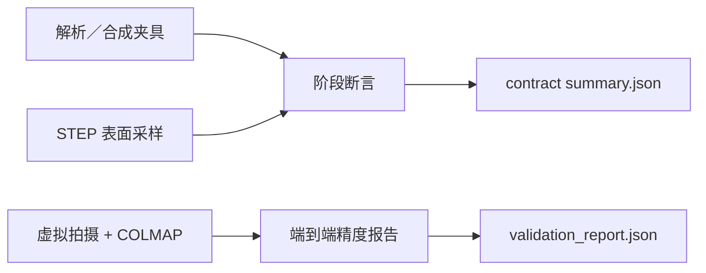

# 案例与验证

本栏目说明仓库中可复现的验证资产、其证据强度与解释边界。所有案例都以仓库内的解析夹具、标准 STEP、虚拟拍摄配置或实拍点云为输入，并以脚本、`manifest.json` 或运行报告中的指标作为判断依据。没有数据支撑的成功率、跨硬件性能结论或“真实照片必然通过”的推断不在这里出现。

## 验证范围与证据类型

验证按“输入从哪来、经过哪条链路、由什么断言验收”组织，而不是按界面功能罗列。阅读具体页面时，应同时关注三件事：

- **输入身份**：点云是否有单位 sidecar，快照哈希是否被记录，参考 STEP 是否独立构造。
- **中间证据**：阶段产物是否有 `artifact.json`、结构化状态、源点 ID 和上游依赖。
- **验收口径**：看到的是必须满足的门槛，还是一次参考运行的实际数值。

三类证据在仓库中并存，覆盖的成本与可信范围不同。

| 证据类别 | 典型入口 | 能证明什么 | 不能直接证明什么 |
| --- | --- | --- | --- |
| 解析／合成夹具 | `tools/contracts/`、`tools/fixtures/`、`tools/validation/run_compound_fit_tests.py` | 指定阶段在可控点云、已知真值下按契约工作 | 图片拍摄、COLMAP 重建和真实噪声下的完整链路 |
| 虚拟拍摄 + COLMAP 端到端 | `tools/validation/run_performance_validation.py` | 62 视角合成拍摄、相机元数据、GPU 稠密点云、识别与 STEP 回读可以串通 | 多次运行成功率、真实工件泛化或独占 GPU 性能 |
| 阶段契约测试 | `tools/contracts/run_reconstruction_contracts.py` 与 `data/reconstruction-contracts/v1/manifest.json` | 01–34 模块在固定夹具或共享点云下的输入输出、依赖和阻断关系 | 未列入清单的算法分支、人工交互或生产界面的全部行为 |

虚拟拍摄链路的参考运行记录为 **2026-10-04**；其中的点数和精度只代表该次运行，不能当作重复运行的统计结果。端到端页面会单独标注这些数值。

## 子页导航

| 页面 | 一句话说明 |
| --- | --- |
| [数据集与复现约定](/validation/datasets) | 说明解析点云、STEP 采样、虚拟拍摄点云和实拍点云的来源、单位、真值与报告位置。 |
| [贯穿孔与盲孔](/validation/hole-cases) | 以 `box-through-hole` 和盲孔拒绝用例说明孔识别的验收指标与失败条件。 |
| [U 形槽与装配案例](/validation/projection-assembly-cases) | 说明 U 形槽截面／实体、装配分组闭合，以及部分结果与 `unsupported` 诊断。 |
| [阶段契约与回归测试](/validation/contract-tests) | 说明 manifest v1 的 01–34 模块、81 个用例、fixture／cloud 模式与失败定位方法。 |
| [端到端精度与性能评测](/validation/end-to-end) | 说明 62 视角图像到点云、点云到 PCAD／STEP 的参考精度与耗时解释边界。 |

## 阅读约定

- **验收门槛**来自 `case.json`、`manifest.json` 或脚本中的判定条件，是运行必须满足的约束。
- **参考结果**来自一次已记录的运行，通常注明日期；它不自动构成回归门槛。
- 报告目录统一位于 `outputs/` 下，生成物不进入版本库。案例源模型和定义仍保存在 `data/`。
- 参考标签、源 STEP 拓扑和真值实体只在检测完成后用于核对；检测入口不读取它们。
- 出现 `unsupported`、`blocked_upstream` 或 `cad_accuracy_failed` 时，应读取结构化报告定位阶段，而不是把“未通过”解释为“没有运行”。

具体页面按以下方式记录结论：

- 先给出输入与案例定义，再列出验收门槛，最后给出参考运行数值；
- 参考运行注明日期和“单次运行”，不把单次结果写成稳定通过率；
- 失败案例保留原始状态和错误类别，不用后续成功结果覆盖旧记录；
- 需要比较实现变化时，使用同一输入、同一 manifest 版本和同一容差。

常见误读包括：把 `complete_cad_fit=false` 理解为流程没有运行；把 `blocked_upstream` 理解为当前阶段算法失败；把 `unsupported` 理解为没有产生任何中间诊断。三者在报告中都保留阶段、状态和错误字段，应按字段而不是按最终布尔值解释。

