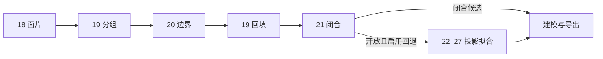

# U 形槽与装配案例

U 形槽用于验证投影拉伸的选轴、区间、截面和评分；装配案例用于验证面片提取、分组、边界恢复、全量回填与壳闭合。两者都强调“有观测支持才闭合”，不把包围盒或邻域连通性当作实体证据。

> 这两类路径当前属于 legacy：生产重建默认使用实体推断，装配案例需要离线显式 `--legacy-assembly` 才会运行；投影拟合仍可从调试入口独立调用。

## U 形槽的截面与实体

`u_channel` 数据集由解析点云生成，契约容差为 0.075 mm，最多允许 1 个操作。其截面定义为外框 12 × 10 mm、拉伸深度 6 mm，槽口从顶边向下 7 mm、宽 4 mm；因此两侧壁各厚 4 mm，底部厚度 3 mm，名义截面积 92 mm²。

| 阶段 | 用例 | 断言门槛 |
| --- | --- | --- |
| 22 候选轴 | `m22.u_channel.axes` | 至少 1 条轴，最大 \|z\| ≥0.999 |
| 23 区间 | `m23.u_channel.interval` | 深度 5.95–6.05 mm，\|z\| ≥0.999 |
| 24 截面 | `m24.u_channel.profile` | 线性截面面积 88–96 mm² |
| 25 提案 | `m25.u_channel.proposals` | 基体提案 ≥1，次操作数 0 |
| 26 评分 | `m26.u_channel.score` | 体积 528–576 mm³，内点率 ≥0.9，P95 ≤0.225 mm |
| 27 搜索 | `m27.u_channel.search` | 接受，操作数 1，体积 528–576 mm³ |

候选轴优先来自平面证据，也可由 PCA 方向与侧壁法向补充。模块回归会构造拥挤证据，确认候选数量受预算限制，且每个 PCA 主方向只保留一个候选。区间阶段要求两端都有截面支持；把一侧法向改成侧向法向后，缺失端面不会被误当作有效端盖。

截面阶段从有观测的端面恢复折线与整圆。单轴拉伸测试用实体分类器确认：槽口内点 (0, 3, 3) 在实体外，壁内点 (4, 3, 3) 在实体内，体积除以深度应保持 92 ± 4 mm²。该检查同时覆盖“开口保留”和“四单位壁厚保留”，不以矩形外框替代 U 形轮廓。

投影拟合的生产通过门槛为：评分样本内点率至少 90%，采样点到实体边界的距离 P95 不超过容差的 3 倍，缺少观测支持的模型面面积比例不超过 4%。默认容差为部件包围盒对角线的 0.25%；契约用例显式给出 0.075 mm，因此 P95 门槛为 0.225 mm。多轴竞争、两轴求交和错形实体评分分别由投影阶段回归覆盖。

## 装配分组与闭合

装配串联顺序为 **18 面片 → 19 分组 → 20 边界 → 19 全量回填 → 21 闭合**。20 读取装配工作样本，回填发生在边界恢复之后；21 基于完整观测判断闭合，并保留“闭合前观测轮廓”与“闭合后轮廓”两个版本。



| 数据集 | 18 面片 | 19 分组 | 20 边界 | 19 回填 | 21 闭合 |
| --- | --- | --- | --- | --- | --- |
| `two_boxes` | 12 个面片，2304 个工作点 | 2 个部件 | 12 个环 | 未分配源点 0–3 | 2 个闭合体，体积 375 ± 1e-5 mm³ |
| `open_box` | 5 个面片，1280 个工作点 | 1 个部件 | 5 个环 | 未分配源点 0 | 0 个闭合体，体积约 0 |

`two_boxes` 包含 6 × 8 × 5 mm 与 3 × 5 × 9 mm 两个分离箱体；核心回归还打乱点序、重编号、整体缩放平移并做三维旋转，要求分组和体积不依赖点 ID 或坐标位置。`open_box` 用 `missing_face: 5` 故意缺少一个面，闭合阶段报告开放边，而不是补出一个未观测的盖面。

闭合若调整轮廓，`boundaryBeforeClosure` 保留观测环，`revisionSource` 记录为 `convex_support_planes` 或合并共面面片；记录中的观测顶点保持不变。开放壳与可恢复件并存时，只导出通过验证的部件：例如一个缺盖箱体加一个完整箱体，结果是 1 个闭合体、2 个候选部件，闭合体体积 192 mm³，覆盖率严格位于 0 与 1 之间。

`box-wall` 是 `data/real-workpieces-step/box-wall/` 下的已有工件回归样本，用于装配与生产入口的联调；它不在当前 manifest 中声明固定数值门槛。可量化的分组、边界和闭合断言仍以 `two_boxes`、`open_box` 的契约用例为准。

装配结果的 `surface_coverage` 表示归属于闭合候选的观测点比例，不是原模型恢复率；报告通过 `coverage_basis` 明确这一语义。未闭合候选即使有完整边界，也不能仅凭覆盖率被当成实体。

## 开放部件与部分结果

装配结束后，开放且至少包含 2 个面片、点数达到门槛的部件可以进入投影回退。生产任务按点数从大到小处理，最多尝试 6 个开放候选；接受后部件状态变为 `closed_projection`，其操作序列并入候选。该回退默认启用，可用 `--mode assembly-no-projection` 或 `--no-projection-fallback` 关闭。

部分成功与完全失败分开报告：

- **部分装配**：至少一个部件通过验证并导出时，报告 `partialAssembly=true`，验证状态为 `cad_exported_partial`，`partial_reconstruction=true`。导出的 PCAD／STEP 只包含有效实体，开放部件与诊断继续保留。
- **`unsupported`**：没有可验证实体时，状态为 `unsupported`，记录错误并停止 CAD 导出；但装配诊断仍写入 `parts.json`、`segmented.ply` 与 `segmented.json`。
- **诊断口径**：`parts.json` 汇总 `candidate_parts`、`closed_parts`、`open_parts`、`projection_attempted_parts`、`projection_reconstructed_parts`、`unreconstructed_parts`、`unassigned_points` 与 `open_edges`；每个部件保留状态、原因、开边数、非流形边数和投影诊断。
- **身份声明**：诊断报告写明 `source_model_read=false`、`original_instance_identity_verified=false`，分割标签注明为推断的部件候选，不是参考标签。

复现命令：

```powershell
python -m tools.reconstruction.run_point_cloud_cad --mode assembly --input part=path/to/cloud.ply --output outputs/assembly-fit
python -m tools.contracts.run_reconstruction_contracts --mode cloud --case m21.two_boxes.closure --output outputs/contracts-closure
python -m tools.contracts.run_reconstruction_contracts --mode fixture --case m24.u_channel.profile --output outputs/contracts-profile
```
